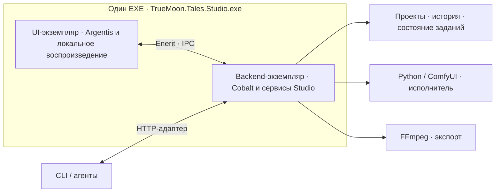

# True Moon Studio — архитектура

> Studio 0.15 / M2: код независим от Book; текущие пути, конфигурация и правила
> совместимости описаны в [Workspace.md](Workspace.md). Старые отчёты фиксируют
> прежние версии. GPU запускается только отдельной явной операцией launch.

## Целевая модель запуска

Согласовано 07.11.2026: Studio поставляется с одним исполняемым файлом
`TrueMoon.Tales.Studio.exe`. Пользователь запускает UI-экземпляр; средствами
фреймворка запускается служебный backend-экземпляр того же EXE в отдельном процессе.
Все backend-сервисы работают внутри этого служебного экземпляра. Отдельный backend
EXE или отдельный исполняемый проект для него не создаётся.

- **Роли и композиция.** Роль экземпляра выбирает конфигурацию приложения:
  UI получает окно, медиаслой и IPC-клиенты, backend — прикладные сервисы и IPC-host
  без окна. В каждом экземпляре Cobalt создаёт и освобождает собственные сервисы.
  Program остаётся общей минимальной точкой входа с fluent-композицией; выбор роли
  и её настройка находятся в конфигурационных расширениях. Backend — логический
  модуль приложения, а не отдельная программа.
- **Владение данными.** Backend владеет записью проекта, историей, ревизиями,
  заданиями и регистрацией результатов. UI ведёт локальный черновик и отправляет
  команды с `expected_revision`. Python возвращает артефакты генерации. На этапе
  переноса у проекта сохраняется один владелец записи — текущий Python-сервис
  либо новый C# backend. Backend управляет принадлежащими Studio исполнителями,
  хранит состояние заданий и при восстановлении сверяет его с артефактами.
- **Связь.** UI и backend используют типизированные вызовы Enerit через именованные
  каналы. Перед подключением проверяются роль, готовность и версия контрактов.
  Через IPC передаются команды, состояние, ревизии и разрешённые ссылки на медиа;
  кадры и звук читаются локальным медиаслоем UI. HTTP-адаптер для CLI и агентов
  вызывает те же прикладные операции backend.
- **Жизненный цикл.** Проверить штатный механизм TrueMoon/Mithril для запуска
  backend-экземпляра того же EXE и управления только принадлежащим Studio
  экземпляром. В план входят готовность, ошибки старта, ограниченное ожидание,
  остановка, аварии и повторное подключение. Разрыв IPC требует перечитать
  состояние проекта и заданий; отмена задания остаётся отдельной командой по ID.
  Prepare, launch и collect сохраняют раздельные операции без повторной отправки
  генерации при восстановлении.

Это согласованное архитектурное решение, реализация запуска двух ролей ещё
предстоит. Текущий C# UI работает через HTTP с Python-сервисом. Этапы и критерии
перехода — в [Plan.md](Plan.md#прототипы-и-порядок-перехода).

## Реализация Python / Web

30.10.2026. Реализация UI-00/01 и начальной части UI-02/03. Существующие планы/карточки/арты остаются исходниками; приложение хранит своё состояние в `Studio.project.json` в корне ролика рядом с роликом и снимки истории в `Production/History/`. Глава, лор и музыкальная сетка не редактируются импортом.

## Экраны

1. Верхняя навигация открывает обзор сценария, карточку сегмента и исходник блока. Справа инспектор переключается между «Исходник» и «В монтаже». Внизу доступен общий таймлайн. [Точки входа](Scenario.md#где-редактировать).
2. Обзор проекта: сегменты, материалы и состояние отбора. Неизвестное монтажное окно показывается как неизвестное, не подменяется длиной генерации.
3. Отбор: дубли, реальный плеер, сравнение двух результатов и заметки. Технический успех, отбор и приёмка — разные состояния.

Локальный HTTP-сервис Python 3.12, стандартная библиотека; HTML/CSS/ES modules без сборки и CDN. Отдельные зависимости ComfyUI не меняются. Для работы с видео и процессами используются уже установленные в portable Python av/Pillow/psutil. Порт приложения 8787, только loopback; порт ограниченной ComfyUI остаётся 8199.

## Данные и операции

Проект хранит стабильные ID, ревизию и ссылки на материалы в `assets`. Сценарий, исходники и монтаж связаны через ID.

- `timeline.scenario.segments[].items[]` хранит описания сценарных блоков, их плановую длительность, заметки о звуке и стыке, ссылку `block_id` и необязательный `take_id`.
- `blocks[]` хранит исходники с промптом, настройками, референсами и дублями. Guide ссылается на изображение из `references` по `reference_id` и задаёт индекс кадра. Начальная и финальная опоры используют `0` и `-1`. Seed хранится строкой до преобразования в Python int. Верхнеуровневый `segments[]` группирует исходники, сценарные сегменты хранятся в `timeline.scenario`.
- `timeline.segments` и `timeline.clips` хранят допустимую раскладку сценария. Клип использует ID сценарного элемента и указывает на исходник и выбранный дубль. Музыка, звуковые события, переходы и титры дополняют раскладку.

[Модель проекта](Scenario.md#структура-проекта) · [Статус разработки](Status.md).

UI и агенты используют один HTTP API. Запись требует ожидаемой revision: пересекающееся изменение возвращает 409; новая версия не затирает чужую правку. Перестановка референсов перенумеровывает Picture-метки одновременно и сохраняет связи Guides. Встроенная модель ИИ и MCP относятся к следующим интеграциям; первая версия выдаёт фактический контекст блока и API для внешнего агента.

Studio 0.4: `studio/agent.py` хранит рабочую карточку brief в проекте и отдельные versioned AgentRequests со снимком контекста; блокировки Store защищают одновременный claim. Расширенный контекст содержит монтажные размещения/соседей, зарегистрированные медиа и ограниченный список документов с ролями, SHA256 и флагом truncation. `studio_agent.py` — standard-library CLI без автоматических повторов записи; `static/agent-ui.js` — карточка/задания, список статусов и передача в чат. Poll редактора сверяет отсутствие локальных правок до и после чтения удалённой версии. Автоматического вызова внешней модели нет. [Подробности](AgentIntegration.md).

Импорт читает существующие `Shots`, `Frames`, `video` и подготовленные задания, не объявляет автоматически новейшие файлы утверждёнными. Импортированные дубли требуют просмотра. Исходные пути сохраняются; загруженные пользователем новые файлы получают уникальные имена в `Production/Imports/`.

## Генерация

Первая интеграция — Omni.v1.1, новые планы и native AV / Motion Context, размеры 896×512 и 1280×736. Full Transfer через Video 1 ещё не включён в этот UI. Фактическая сетка времени берётся из профиля: `17k+5`, 24 fps; Context 22/18. Источник и монтажное окно независимы.

«Подготовить» сохраняет точный снимок и собирает граф **без очереди и staging в ComfyUI**. «Запустить один дубль» — отдельная операция: проверка хэшей, staging, bounded runner, collect. Повторный запуск того же задания блокируется; все новые задания имеют отдельные каталоги. В приложении одновременно работает один принадлежащий ему запуск. Чужой сервер/очередь сохраняются.

Остановка проверяет PID, время создания и команду принадлежащего запуску процесса. При восстановлении сессии сначала читаются сохранённые Submission/History/Cleanup; автоматической повторной отправки нет. Таймеры ядра/независимый watchdog сохраняются. Реальную GPU-генерацию через UI считать проверенной только после отдельного разрешённого дубля, не по одному JSON и имитации.

## Границы первого выпуска

Обновление 31.10.2026: Studio 0.2 добавляет UI-04A, описанный ниже; исходные границы версии 0.1 сохранены как история.

Первый выпуск должен реально открывать, редактировать, сохранять и восстанавливать блок, показывать изображения/MP4 и архивные дубли, проверять промпт/опоры, готовить задания и предоставлять общий агентный API. Монтаж с переходами/титрами/звуком, финальный экспорт, встроенный LLM, MCP и функции адаптаций UI-06–11 остаются следующими этапами. Элементы, которые ещё не работают, не выдаются за готовые действия.

## Монтажная модель 0.2

В проект добавляется необязательный `timeline`: version, fps, segments, clips, markers и две ограниченные истории undo/redo (30 состояний). При чтении старого проекта запись миграции не выполняется. Монтажный segment задаёт диапазон, а clip — использование исходного block/take с абсолютным началом, длиной и входом в источник в кадрах проекта. Исходные группы карточек не являются автоматически монтажными диапазонами. Один дубль допускает несколько использований.

`studio/timeline.py` проверяет диапазоны, непересечение, принадлежность дубля и длину источника. `Store.timeline_operation` выполняет операции под lock с expected_revision, общей историей и атомарным сохранением. Отмена заменяет только монтажное состояние, сохраняя новые дубли и правки блоков. Недостающие метаданные старого видео считываются PyAV и записываются вместе с успешным назначением; ошибочная операция не сохраняет частичный результат.

`static/timeline.js` отображает общий таймлайн, pointer-переносы/обрезку, клавиатуру и числовые поля. `timeline-logic.js` содержит расчёты времени, привязок и предварительной проверки. Библиотека источников использует pointer-перенос без зависимости от HTML5 dataTransfer. Общий GET/POST `/api/projects/{pid}/timeline` доступен UI и агентам; никаких вызовов ComfyUI эти операции не выполняют. Studio 0.3 добавляет просмотр монтажа; экспорт остаётся следующим этапом.

## Музыка и просмотр 0.3

`studio/audio.py` потоково декодирует звук PyAV на CPU, сохраняет максимумы абсолютной амплитуды всех каналов с частотой 100 Гц. Отдельный процесс ограничен 45 с. `Store.waveform` проверяет SHA256 до/после анализа, валидирует кэш и не меняет проект. Музыка — отдельное монтажное использование одного audio asset; перемещение/обрезка меняют целые кадры, сохраняя исходник. Старый timeline получает music=null и clip_audio=false при чтении без миграционной записи.

`audio-timeline.js` расширяет таймлайн музыкальной полосой и транспортом. Canvas рисуется только в пределах видимого окна, независимо от полной ширины музыки. `playback-logic.js` рассчитывает клип, вход в источник, музыкальное окно и слышимое время AudioContext. `montage-player.js` планирует музыку Web Audio и использует два постоянных video для текущего/следующего клипа. Аудиочасы ведут время в чёрных паузах и заглушках; кадровая скорость видео остаётся 1×. Позиционные правки останавливают просмотр; маркеры, громкость и mute применяются без остановки. Поздние результаты decode/play от прежнего состояния не запускают старое воспроизведение.

Во время проигрывания video не перематывается на каждом кадре: восстановление только при отклонении свыше 0,25 с, максимум раз в секунду. На паузе устанавливается точная исходная позиция. Это браузерный монтажный preview с возможной задержкой декодирования, не обещание покадрового совпадения с будущим MP4. [Проверки и измеренные ограничения](Verification/AudioPlayback.v1.Report.md).

## Сценарий 0.5

`studio/scenario.py` читает существующие монтажные размещения без миграционной записи. При первой сценарной правке timeline.scenario становится каноническим намерением с отдельными описаниями и длительностями использований. get вычисляет последовательную раскладку/паузы и issues; при отсутствии issues обновляется монтаж, иначе сохраняется последняя допустимая проекция. Общая история timeline содержит optional scenario, включая восстановление legacy без сценария. Источники/дубли/промпты не откатываются вместе с монтажом.

`scenario-logic.js` строит видимый план с теми же правилами; TimelineView может показывать эту проекцию, а общий MontagePlayer использует сохранённый допустимый монтаж. UI блокирует общий просмотр конфликтного/неопределённого плана. `scenario-ui.js` даёт дерево, карточки, формы и выбор источника/дубля. [Контракт и ограничения](Scenario.md).

## Просмотр сегмента и материалы 0.6

`segmentPlayback` в `playback-logic.js` проверяет выбранный сценарный сегмент и создаёт представление только с его клипами и диапазоном, сохраняя абсолютные позиции и глобальную музыку. MontagePlayer использует те же часы, видео и музыкальный кэш; ограничивает seek/play/stop и запланированный звук границами диапазона. Чужие сценарные ошибки не блокируют допустимый отдельный сегмент. Удаление/повреждение выбранного окна останавливает просмотр, смена проекта очищает область. Общий таймлайн остаётся общим; локальная шкала даёт перемотку внутри окна. Область просмотра не записывается в проект.

`static/materials.js` отображает раздельные References/Guides и содержит чистые операции привязок. Формат references/guides, API, сборка графа и файлы не мигрируют: Guide по-прежнему ссылается на reference_id. Удаление одной опоры сохраняет изображение; удаление reference снимает только связанные Guides и перенумеровывает Picture. Загрузка из вкладки опор явно добавляет изображение и Guide, обычная загрузка — только reference. Асинхронные ответы загрузки/перестановки не заменяют переключённый блок или несохранённый черновик. [Работа и проверки](SegmentPreview.md).

## Сценарные задания агенту 0.7

`static/scenario-agent-ui.js` подключается к ScenarioDesk: формы подготовки/улучшения, состав работы, список scoped-заданий и явная передача чату. Poll обновляет статусы отдельно от project revision. Поздние ответы сверяют проект, сегмент и DOM; форма сохраняет revision/запрос при конфликте, rebase читает свежий проект. Client key даёт идемпотентный повтор отправки, без автоматического ретрая.

`studio/agent.py` проверяет сценарную область, выводит source block из item и сохраняет task/context в прежнем AgentRequests. Снимок содержит сценический сегмент, использование, соседей и число использований источника. Создание задачи не создаёт блок и не пишет проект; внешний агент создаёт его через сценарный API. Finish подготовки обязан связать новый item того же сегмента; ID из исходного снимка не принимается как новый результат. Project writes и task writes по-прежнему имеют независимые revision/lock. Старые unscoped-задания не требуют миграции. Автоматического вызова модели, shell или GPU внутри задач нет. [Контракт](ScenarioAgent.md).

## Монтаж источника 0.8

`studio/clip_edit.py` и `static/clip-edit-logic.js` задают один контракт: optional speed (0.25–4, default 1), исключающий source_out_frame и дробные source-позиции у retimed-клипа; montage duration=ceil(source span/speed), время проекта — целые кадры. Legacy без новых полей сохраняет прежнюю форму. Новые операции проходят через scenario.translate/apply, принимая legacy-размещения без изменения источников. Одна операция — одна история; split создаёт новое использование прежнего source/take.

Anchor_frame хранит закреплённое начало: предшествующая укладка расходует ожидание, но не сдвигает акцент. Переполнение даёт anchor_overlap и сохраняет последнюю допустимую проекцию. Gap_protected удерживает длину явной паузы при compact_segment. Все вычисления/проверки отражены в scenario-logic.js. Исходный блок/отбор/генерационные входы независимы от монтажного использования.

`clip-editor.js` читает выбранный clip и фиксирует revision формы; TimelineView.write поддерживает явную revision с возвратом ошибки в сохранённую форму. PlacementAt преобразует абсолютное время через скорость; MontagePlayer задаёт playbackRate видео, сохраняет музыкальные часы и ограничивает источник его исключающим концом. Кнопка разреза обновляется вместе с курсором, без пересоздания формы на каждом кадре. [Работа и ограничения](ClipEditing.md).

## Черновой экспорт 0.9

`studio/export_plan.py` под lock читает проверенный снимок монтажа с expected_revision; разрешает выбранные assets через настроенный resolver и замораживает read/write/protected-политику CPU worker и раскладывает абсолютную сетку времени на клипы/чёрные паузы. Размер, fps, диапазоны, скорость, music и clip_audio фиксируются в Request.json. Снимок/запуск не меняют проект или Jobs. `studio/exports.py` хранит отдельные revision статусов, client key, единственный активный CPU-экспорт, монитор с внешним лимитом 305 с и восстановление без повторного запуска. Остановка проверяет PID, время создания, точный export_worker.py и папку задания; чужой процесс не останавливается.

`studio/export_worker.py` потоково декодирует PyAV, выбирает последний native кадр не позже рассчитанного source time и отдаёт ровно один кадр на каждый tick проекта. В памяти удерживаются текущие/следующие кадры, а не весь фильм. Pillow вписывает изображение в чёрный холст, PyAV пишет H.264 с двумя потоками CPU. FFmpeg из уже установленного imageio_ffmpeg собирает звук: native trim/atempo → PCM/WAV с точными длинами и тишиной для пауз → музыка с участком/gain/mute/задержкой → один AAC и MP4 faststart. Промежуточный PCM предотвращает AAC priming на каждой склейке. Пути передаются argv без shell; внутренний deadline 300 с дополняет монитор Studio.

Хэши входов проверяются до/после, результат проверяется по числу кадров и fps. Status/Progress/Result пишутся атомарно. Только completed выдаёт MP4 через существующий Range/HEAD-ответ. После аварии подтверждённый Result с совпадающим SHA256 может быть принят; остальное становится interrupted. Просмотр результата останавливает монтажный плеер; poll списка не пересоздаёт video. [Контракт и проверенные пределы](DraftExport.md).

## Звуковые события 0.10

`studio/sound.py` задаёт optional timeline.sound_events, проверку источников/полей и относительную укладку. Данные входят в timeline.content/undo; scenario.remove_segment убирает связанные события тем же действием. Времена не хранятся абсолютными копиями: перенос сегмента отражается при placed(). Store анализирует выбранный поток перед привязкой; waveform теперь допускает видео/stream с отдельным ключом кэша. sound-preview извлекает только выбранный участок в WAV через bounded FFmpeg, не меняя проект; публикация кэша выполняется после проверки хэша источника. UTF8 вывода subprocess задан явно для Windows.

`static/sound-logic.js` вычисляет абсолютные позиции и schedule из уже обрезанного буфера. MontagePlayer готовит WAV-буферы до установки общих AudioContext-часов, планирует звуки вместе с музыкой и останавливает все узлы при pause/seek/смене проекта. SegmentPlayback фильтрует события сегмента и сохраняет жёсткое окно. SoundDesk предоставляет форму/волну/конфликтный draft; AudioTimelineView показывает занятые ролевые дорожки. UI-операция сохраняет захваченную revision; запоздалые ответы не применяются после смены проекта/окна.

ExportPlan фиксирует выбранные audio/video assets и sound tail; export_worker смешивает выбранные аудиопотоки с trim/gain/mute/sample delay и прежними native/music путями. Agent context даёт sound_sources; общий CLI timeline использует API. [Контракт/ограничения](SegmentSound.md), [проверки](Verification/SegmentSound.v1.Report.md).

## Контекстное меню 0.11

`static/timeline-menu.js` содержит каталог прежних команд и жизненный цикл меню. TimelineView подключает contextmenu и Shift+F10/Menu к клипам/сегментам; app передаёт существующие сценарные формы, просмотр, блок и звук. Меню ставит паузу, выбирает элемент и синхронизирует render signature без переноса курсора/записи. Снимок target/project/revision/frame проверяется перед командой, montage writes используют expectedRevision. Новых серверных операций/полей нет.

Меню находится в body с fixed-позицией, помещается в viewport и поддерживает ARIA menu/menuitem/menuitemcheckbox, отключённые команды, стрелки/Home/End, native Enter/Space, Escape/Tab и возврат фокуса. Слушатели внешнего клика/scroll/resize снимаются при закрытии; реальная перерисовка проекта также закрывает меню. Обычное обновление полей preview меню не пересоздаёт. [Инструкция](TimelineMenu.md), [проверки](Verification/TimelineMenu.v1.Report.md).

## Плотность таймлайна 0.12

`static/timeline-layout.js` задаёт UI-политику и localStorage-ключи для story/editing. По умолчанию карточка компактная, редактор полный; явные предпочтения независимы. TimelineView включает layout в render signature и root dataset/classes, игнорирует старый collapsed в compact, показывает properties по запросу. Переключение не записывает проект, не меняет cursor/zoom/selection и не трогает preview-stage. При смене контекста временно открытые свойства закрываются.

`timeline-layout.css` уменьшает реальные полосы/гуттеры/границы, сохраняя ту же timeline geometry по X и прежние обработчики. AudioTimelineView задаёт высоту ролевых полос и рисует музыку на canvas 24 px в compact / 52 px в full; предупреждения о конфликтах остаются доступны. Дополнительной копии таймлайна/данных нет. [Инструкция](CompactTimeline.md), [проверки](Verification/CompactTimeline.v1.Report.md).

## Переходы через чёрный 0.13

`studio/transitions.py` валидирует соседние пары и бюджет fade/pause, строит абсолютные окна и midpoint brightness. Optional rows входят в timeline.content/history; prune вызывается после изменения допустимой проекции и убирает только разорванные пары. Scenario validation errors возвращаются как StudioError422. Неизвестный/конфликтный сценарий запрещает set_transition. Геометрия/звук не меняются.

`transitions-logic.js` зеркалит сетку/проверку, TimelineView рисует seam-кнопки и полосы эффектов. TimelineMenu kind=join использует прежний безопасный lifecycle без выбора/перемещения клипа, TransitionsDesk сохраняет захваченную revision и draft при ошибке. SegmentPlayback компилирует глобальные окна до фильтрации клипов, чтобы входящая/исходящая межсегментная фаза сохранялась. CriticalSignature учитывает rows/windows.

MontagePlayer вычисляет brightness на текущем целом кадре и накладывает чёрный слой; badge остаётся служебным элементом preview. ExportPlan фиксирует окна, export_worker умножает RGB каждого output frame от исходного cached изображения, без накопления на hold/slow frames. Аудиосборка не меняется. Сравнение независимых JS-позиций и PyAV-декодирования выполнено для всех 168 реальных кадров. [Инструкция](BlackTransitions.md), [проверки](Verification/BlackTransitions.v1.Report.md).

## Титры 0.14

`studio/titles.py` валидирует optional timeline.titles и создаёт cropped RGBA глифы через установленный Pillow/TrueType. Кэш привязан к оформлению, canvas и SHA шрифта/PNG; Style preview пишет только производные файлы. Store проверяет размещение и общий 16M pixel budget до commit, title_lock защищает кэш. TitleCompositor держит LRU четырёх активных слоёв, не изменяет исходные cached RGB. Чёрная карточка — единая группа `base*(1-opacity)+glyphRGB*glyphAlpha*opacity`, прозрачная подпись — обычное alpha-over. Слои следуют после затемнений видео; звук независим.

`titles-logic.js` задаёт общие midpoint-фазы и расположение PNG в рамке проекта. `titles-ui.js` содержит редактор/список, debounce чернового PNG, захваченную revision, guards смены проекта/модальной формы и защиту двойной записи. AudioTimelineView добавляет полосы титров и редактор по клику. MontagePlayer заранее декодирует PNG, ждёт их перед стартом, вписывает видео/blackout/глифы в одну каноническую рамку через ResizeObserver; внешний размер preview сохраняется. Порядок title rows даёт z-order. SegmentPlayback оставляет абсолютные времена и global title_signature до фильтрации.

ExportPlan включает title ends в extent и фиксирует PNG-активы/суммы SHA вместе с текстом. Worker проверяет SHA и накладывает те же глифы с теми же фазами. Отдельные титры работают и без видео. Сжатие H.264 и масштаб браузера не дают битового тождества, но метрики/переносы/положение/время общие. [Инструкция](Titles.md), [проверки](Verification/Titles.v1.Report.md).

## Разделение кода и данных · M2

`studio/paths.py` хранит версионированную конфигурацию корней, named paths и prefix aliases.
Store использует её для чтения, отдельной проверки записи и сериализации новых путей.
Legacy Store-конструктор сохранён для совместимости тестовых fixtures; production app
всегда загружает конфигурацию. Старые ID/path и immutable снимки не нормализуются
путём перезаписи. Производные cache и новые exports могут находиться вне проектов.
Профили и шаблоны подготовки принадлежат репозиторию кода, runtime Python/Comfy
передаются через конфигурацию. `TrueMoon` исключён из чтения и записи.
