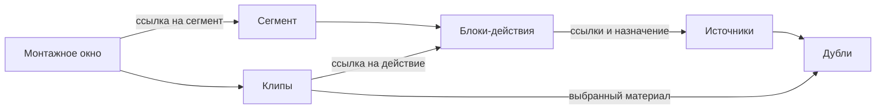

# Модель проекта Studio

Согласовано 09.11.2026. C#-редактор применяет модель действий, источников и
нескольких клипов в schema2 на экране «Сценарий и материалы». Python HTTP
использует поля schema1.
[Совместимость](#совместимость-с-текущими-проектами) ·
[План реализации](Plan.md#переход-к-модели-действий-и-источников).

## Сущности

**Сценарий → сегменты → блоки-действия.** Библиотека хранит источники и дубли;
монтаж реализует действия клипами в окнах сегментов.

| Сущность | Ответственность |
|---|---|
| Сегмент | Смысловая часть ролика: название, тип, содержание и порядок действий |
| Сценарный блок | Целое экранное действие, его смысл, описание, звук/стык и плановая длительность. Может состоять из одного плана или нескольких склеек |
| Источник | Постановка генерации или импортированный материал, настройки, референсы, временные опоры и доступные дубли |
| Дубль | Конкретный вариант материала с файлами, метаданными, происхождением и состоянием отбора |
| Клип | Конкретное монтажное использование дубля либо заглушка: связь с действием, положение, участок, скорость и параметры воспроизведения |
| Монтажное окно сегмента | Размещение того же смыслового сегмента на шкале: ссылка на него, начало, длительность и правила временной раскладки |

## Связи и владение

- Действие допускает отсутствие источников на этапе текста и аниматика, затем
  использование одного или нескольких источников. У связи с источником можно
  указать назначение: основной план, реакция, деталь или перебивка.
- Один источник может участвовать в нескольких действиях. Блок хранит ссылки;
  файлы, постановка и история дублей сохраняются у библиотечного источника.
- Один блок реализуется одним или несколькими клипами. Число клипов может
  отличаться от числа источников: повторное использование источника создаёт
  отдельные монтажные использования с собственными участками и ID.
- Источник может оставаться кандидатом. Его связь с блоком не означает включение
  всех его дублей в монтаж. Конкретный дубль и участок выбираются у клипа.
- Разрезание клипа сохраняет сценарное действие и создаёт монтажные части с
  отдельными ID. Удаление клипа сохраняет само действие, источник, дубли и файлы.
  Изменение замысла действия выполняется отдельной сценарной командой.
- На таймлайне блок показывается раскрываемой группой связанных клипов.
  Группировка представляет общую монтажную раскладку и не хранит её вторую копию.
  Название и содержание сегмента берутся из общей смысловой сущности; окно хранит
  монтажные параметры и ссылку на неё.
- Референсы и опорные изображения источника задают генерационные входы.
  Связь действия с источниками описывает материал его экранной реализации.
  Технический успех, наличие материала, монтажная сборка и авторская приёмка
  сохраняются как разные признаки готовности.

Пример: одно действие использует источники A (общий план) и B (крупный план).
Монтаж A → B → другой участок A содержит три клипа двух источников и одно
сценарное действие. Вариант с одним непрерывным планом сохраняет тот же блок.

## Время и рабочий процесс

Плановая длительность действия, длительность исходного материала и фактическое
монтажное время — отдельные величины. Фактическое время определяется размещениями,
паузами и поддерживаемыми переходами; длительности источников не складываются
в бюджет действия автоматически. Неизвестное время сохраняется неизвестным.

По умолчанию окно сегмента фиксировано. Последовательная укладка и изменения
длительности ограничены его бюджетом; соседние сегменты, музыка и защищённые
акценты сохраняют позиции. Переполнение показывается как конфликт. Изменение
окна или пересборка по сценарию — явная операция с проверкой результата.

1. Описать сегменты и действия без обязательного выбора материала.
2. Задать временные окна и собрать аниматик из заглушек или доступных материалов.
3. Связать действия с источниками, подготовить и отобрать дубли.
4. Собрать действия из клипов, уточнить склейки и звук.
5. Сопоставить замысел, доступный материал и фактический монтаж, выполнить приёмку.

## Первый этап CSharp

10.11.2026 реализованы [C#-контракты и read-only адаптер текущего формата](src/ProjectContracts.md).
DTO транспорта представляют несколько источников и клипов у одного действия;
старый документ читается с сохранением полного оригинала.
[ProjectStore, схема хранения 2 и явная миграция](src/ProjectStore.md) реализованы
отдельной DLL. Read-only открытие реализовано в [STUDIO-BACKEND1](src/Verification/BackendReadOnly.md).
[STUDIO-BACKEND2](src/Verification/BackendMove.md) добавляет перенос через Enerit,
expected_revision и явную передачу writer на schema2-копии.
[STUDIO-BACKEND3](src/Verification/BackendHttp.md) подключает HTTP/CLI того же
writer. Этап 2В добавляет создание сегмента и текстового действия, связи с
источниками, импорт ссылки на видео, перепривязку и ручное размещение нескольких
клипов одного действия. Плановая длительность остаётся у действия, фактические
участки сохраняются у клипов. [Рабочий процесс](src/WindowDesign.md#scenario-library).

## Совместимость с текущими проектами

Ниже перечислены существующие имена, а не новый API-контракт:

| Текущее представление | Смысл и ограничение |
|---|---|
| `project.blocks[]`, source `block_id`, `/blocks/{id}` | Библиотечные источники, прежнее название «исходные блоки» |
| `timeline.scenario.segments[].items[]` | Сценарные использования с одной ссылкой на источник и монтажными полями |
| `timeline.segments` | Допустимые монтажные окна; при активном сценарии строятся как его проекция |
| `timeline.clips` | Допустимые размещения; в активном сценарии ID совпадает с ID сценарного использования |

В прежнем файле schema1 целевые связи «действие — несколько
источников — несколько клипов» ещё предстоит реализовать. Текущий split создаёт два сценарных использования; новая модель
требует сохранять одно действие при разделении его клипа. Прежние кнопки,
payload и названия полей в [API.md](API.md) и инструкциях относятся к работающей
версии. Новые поля и команды вводятся только вместе с версионированным контрактом.

При переходе сохраняются прежние ID, связи, тайминги, пути, история и immutable
снимки. Совпадение старых ID действия и клипа допускается адаптером совместимости,
но их равенство не становится инвариантом новой модели. Открытие/чтение проекта
не запускает миграцию или генерацию. Проверка преобразования выполняется на
изолированной копии с возможностью вернуться к рабочей версии.

Все изменения проходят через одного владельца записи проекта с
`expected_revision`, атомарным сохранением, историей и защитой черновика.
В целевой C#-архитектуре это backend-экземпляр того же EXE; Python возвращает
артефакты. [Модель запуска](Architecture.md#целевая-модель-запуска) сохраняется.

17.11.2026: [STUDIO-BACKEND4](src/Verification/BackendMedia.md) разрешает video asset
по сохранённым source/take IDs и Properties.assets через trusted aliases. Пути
в DTO остаются данными; запрос выбирает asset ID и baseline, не filesystem authority.
Чтение одиночного CFR-кадра не меняет модель, ID, source-in/out, speed или историю;
schema2/ProjectContractv1 сохранены, Enerit protocol обновлён до3.

17.11.2026: [STUDIO-BACKEND6](src/Verification/BackendTrim.md) отделяет фактическую
длительность монтажного использования от Action.PlannedDurationFrames при trim.
Сценарная UI-проекция C# опирается на фактические клипы; плановое время действия
не переписывается. Существующий 1:1 сценарий пересчитывает последующие клипы с
authored gaps/anchors в фиксированном окне. Неоднозначные M:N/несогласованные
проекции этой командой не редактируются. Schema2/ProjectContractv1 сохраняются;
прежний Python schema1-контур и его операции этим решением не заменяются.
