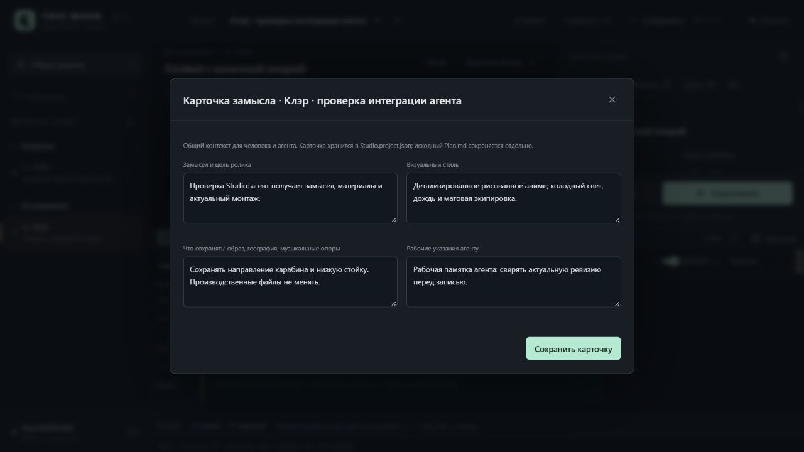
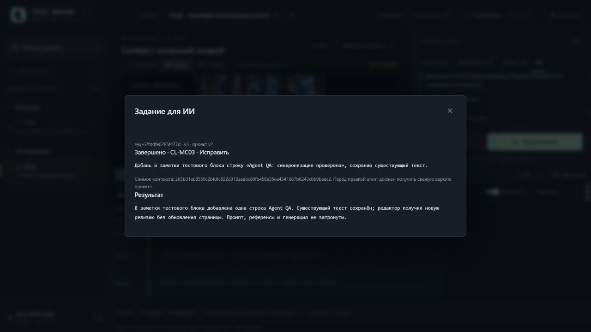

# Studio 0.4 / UI-03A — интеграция внешнего агента

31.10.2026. [Инструкция для автора и агента](../AgentIntegration.md), [машинные результаты](AgentIntegration.v1.Checks.json).

Реализованы карточка замысла проекта, расширенный контекст, сохраняемые задания и командный помощник. UI и агент используют общий API с проверками revision; подготовка и запуск GPU остаются отдельными операциями. Автоматического вызова модели нет.





## Что изменилось

- В Studio.project.json добавляется brief с замыслом, стилем, требованиями непрерывности и рабочими указаниями. Старый проект читается без записи миграции. PATCH сохраняет общую историю и проверяет актуальную revision.
- Контекст версии 2 содержит проект/блок, роли референсов, Guides, дубли, native AV/PNG источника Motion Context, реальный монтаж и соседей каждого использования блока. Есть media-пути/URL, музыка и источники монтажных видео. Документы из фиксированного списка имеют роль, SHA256 и явную отметку обрезки. Secret-справочник автоматически не читается. Legacy /context сохранён.
- AgentRequests хранят goal, propose/apply, владельца, собственную revision, состояние, результат и неизменный снимок контекста. Одновременный claim допускает одного победителя; завершённые задания повторно не открываются. Создание/смена статуса не меняет проект и не запускает вычисления.
- studio_agent.py предоставляет явные read/edit/task/prepare/launch/stop операции через стандартную библиотеку Python. Записи автоматически не повторяются; 409 даёт exit 3. Токен не печатается doctor и не сохраняется в файл. В UI выводятся статус/результат, внешние правки блока подхватываются при отсутствии локального черновика. Guard повторно проверяется после сетевого чтения.

## Реальная проверка UI → CLI → UI

Использован отдельный проект agent-qa в игнорируемом UI/.local/agent-qa-20261031-r1/. Порт 8787 был занят работающим экземпляром пользователя, поэтому тестовый сервер поднят на 8791. Основной сервер не останавливался.

1. Через «О проекте» заполнены и сохранены поля карточки. Во вкладке «ИИ» создано задание propose для CL-MC03. Копирование проверено чтением фактического clipboard: ID, mode, SHA снимка, brief, пять документов и пять референсов присутствовали.
2. CLI выполнил claim; без reload в UI появился owner agent:qa и «В работе». После finish появился «Завершено» и текст предложения. Revision проекта осталась 2, промпт не менялся.
3. Через UI создано apply-задание на добавление одной строки в заметки тестового блока. CLI выполнил claim и patch-block с revision 2. Редактор без reload показал сохранённый исходный текст плюс новую строку, проект стал v3. Finish сохранил отчёт и completed_project_revision=3.
4. Третье задание создано и отменено через UI. Итог: два completed и одно cancelled. Все три снимка проверены пересчётом SHA256.
5. Для проверки конфликта открыта карточка на v3 и введён локальный текст. Параллельный CLI PATCH изменил карточку до v4. Сохранение старой формы вернуло 409; введённый текст остался в форме, серверная правка сохранилась. После явного закрытия/перечитывания показаны актуальные поля.
6. Собственный сервер остановлен и запущен повторно. Карточка, три задания, результаты и ревизии восстановились. После reload console warning/error отсутствуют. Desktop проверен при фактическом viewport 1280×720.

В тестовом проекте нет Production/Jobs: GPU-запусков, подготовки ComfyUI и генерации медиа не было. Производственные файлы агентом не редактировались. Во время проверки автор продолжал работу в основном Studio: файл Клэр изменился с revision 22 до 26 с actor=author. Исходный SHA найден в History, текущие авторские сохранения сохранены; это отдельно отражено в Checks JSON. Production опенинга и оба проектных Plan.md совпали с исходными SHA. Общий план пайплайна/UI обновлён в рамках этой задачи.

## Автоматические проверки

Полный чистый прогон: **143 Python за 11,609 с, exit 0; 40 Node, exit 0; прежний JS logic script PASS**. Python AST, node --check для изменённых JS и git diff --check пройдены. Новые пакеты не устанавливались. Узкий набор новой интеграции: 29 Python и 9 Node.

| Часть запроса «можем улучшить интеграцию для агента?» | Прямое доказательство |
|---|---|
| Карточка замысла и безопасная запись | `test_brief_patch_accepts_12000_chars_merges_fields_and_commits_once`; `test_brief_invalid_shapes_fields_types_actor_and_stale_revision_are_atomic`; реальная UI-форма и конфликт 409 |
| Полный рабочий контекст | `test_context_orders_repeated_placements_and_actual_neighbors_not_block_array`; `test_context_media_includes_take_and_motion_source_paths_with_no_latent_url`; `test_source_docs_are_allowlisted_hashed_truncated_and_exclude_secrets_and_unlisted_files` |
| Передача задания, исполнитель и результат | `test_request_http_full_snapshot_claim_finish_list_and_no_project_or_gpu_changes`; `test_concurrent_claim_at_same_revision_has_exactly_one_owner`; браузерный цикл выше |
| Удобное управление из чата/CLI | `test_cli_request_task_claim_finish_round_trip_is_compact_and_project_read_only`; `test_every_cli_command_maps_to_explicit_route_payload_and_separate_prepare_launch`; `test_cli_conflict_exits_three_without_refetch_retry_or_mutating_request` |
| Сохранность локального черновика и поздние ответы | `editor refresh requires changed revision and no dirty save conflict timeline work or drag`; `request list rejects an older response that arrives after a newer refresh`; `context response for a previously selected block does not overwrite current inspector` |

Новые тесты также проверяют точные текстовые границы 12 000/80/100 000, недопустимые типы/режимы, stale project/request revisions, неизменность терминальных состояний, владельца, отмену, ограничение списка 200, ID/scope, legacy без brief, отсутствие GPU-вызовов, экранирование текста и смену проекта во время await. Assertion/gap review выполнен; процент покрытия не измерялся. Обязательный pairing был вызван, но заблокирован отсутствующим tree-sitter-language-pack; зависимости ради него не устанавливались.

Команды из корня книги:

```powershell
& 'E:/ComfyUI_windows_portable/python_embeded/python.exe' -s -B -m unittest discover -s TrueMoonTales/AMV/UI/tests -p 'test_*.py' -q
node TrueMoonTales/AMV/UI/tests/test_logic.mjs
node --test TrueMoonTales/AMV/UI/tests/test_timeline_logic.mjs TrueMoonTales/AMV/UI/tests/test_timeline_view.mjs TrueMoonTales/AMV/UI/tests/test_playback_logic.mjs TrueMoonTales/AMV/UI/tests/test_montage_player.mjs TrueMoonTales/AMV/UI/tests/test_agent_ui.mjs
```

## Границы выпуска

Задание передаётся внешнему агенту вручную либо читается локальным агентом по запросу автора. Встроенный LLM, MCP, автоматическая отправка в чат, структурированное предложение patch/его сравнение и применение ещё не реализованы. propose/apply — инструкция внешнему агенту, не отдельная система прав. Actor — метка происхождения, не аутентифицированная личность. Отмена задания кооперативная: агент проверяет её перед следующей записью; она не убивает внешний процесс или уже запущенный дубль.

Снимок содержит доступные пути и метаданные, но не доказывает просмотр/прослушивание. Документы длиннее лимита нужно прочитать целиком, когда они нужны для задачи. Карточка проекта не меняет канон и не синхронизирует Plan.md автоматически. Для одного производственного каталога предполагается один сервер Studio; QA использует отдельный каталог. Новая интеграция не проверялась запуском GPU, поскольку текущий запрос этого не требовал.

Временный сервер 8791 и тестовая вкладка после проверки закрыты. Экземпляр пользователя на 8787 не останавливался.
