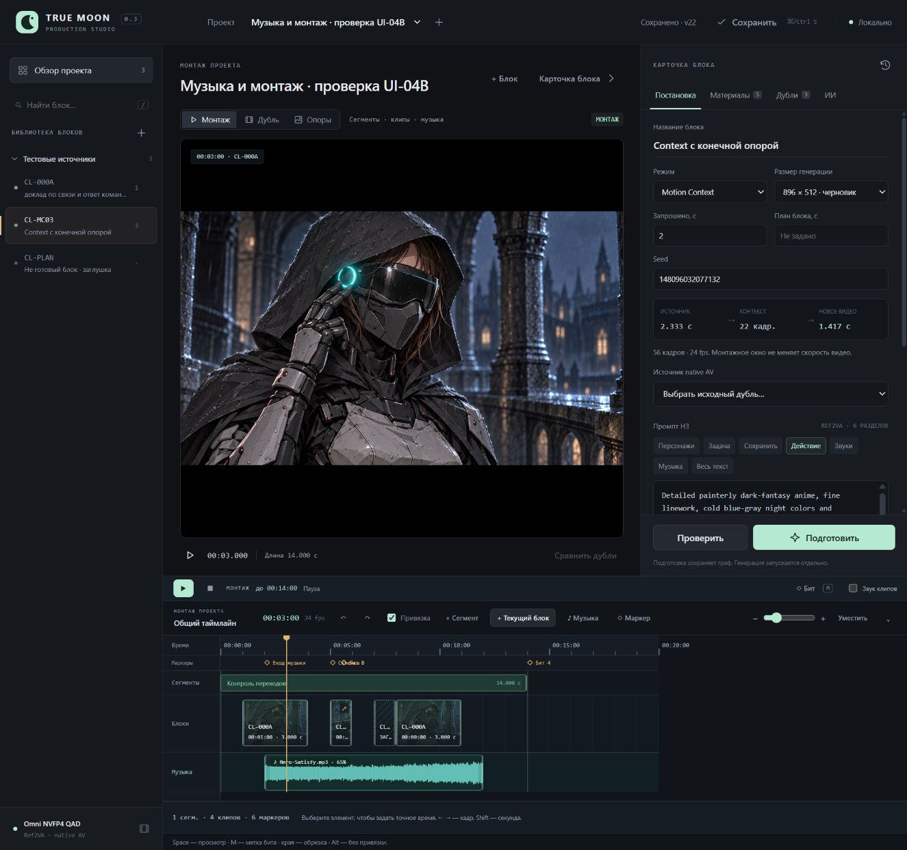

# Studio 0.3 / UI-04B — музыка и воспроизведение монтажа

31.10.2026. Реализованы музыкальная дорожка с волной и просмотр общего таймлайна для подгонки блоков под музыкальные акценты. [Управление](../AudioPlayback.md), [проверки JSON](AudioPlayback.v1.Checks.json).



## Результат

Одна музыкальная полоса хранит начало в ролике, вход в песню, длину, громкость и mute. Доступны загрузка/выбор, перемещение, обрезка мышью и точные поля, отмена/повтор. Волна строится локально на CPU, не требует ComfyUI, кэшируется по SHA256. В режиме «Монтаж» проигрываются выбранные дубли с их исходными входами, чёрные промежутки и обозначенные заглушки; музыкальные часы продолжаются через все участки. Space управляет просмотром, M ставит метку на текущем кадре без остановки. Края клипов привязываются к меткам; Alt отключает привязку. Звук клипов включается отдельно, по умолчанию выключен.

Волна — максимумы абсолютной амплитуды по каналам через 10 мс, не распознавание BPM. Противофазное стерео не отменяет пики. Реальный Nero-Satisfy.mp3: 243,9314375 с в анализе 16 кГц, 24 394 значений, 2 канала, 0,422 с на анализ в QA. Исходный файл совпадает с сохранённым хэшем. Внешний предел worker — 45 с, внутренний — 40 с; звук ограничен одним часом.

## Проверка в браузере

Отдельный проект `playback-qa`, состояние в игнорируемом `UI/.local/playback-qa-20261031-r1/`. Реальные MP4 читаются на месте. Монтаж 24 fps / 14 с: чёрный вход 0–1 → CL-000A 1–4 (исходный вход 1 с) → чёрная пауза → MC03 5–6 (вход 0,25 с) → пауза → заглушка 7–8 → повтор CL-000A 8–11 (вход 0) → чёрный хвост. Для проверки смещений музыка начинается в ролике на 2 с, в песне на 44 с, длится 10 с. Это тестовые параметры; утверждённая сетка Клэр ими не заменена.

- Полный проход Studio 0.3 остановился точно на 14,000 с. Зарегистрированы все восемь ожидаемых состояний: четыре чёрных участка, три видео и одна заглушка. 833 проверки текущего видео, 0 проверок состояния загрузки, 0 восстановительных перемоток. Предзагрузка следующего клипа работает без постоянного пересоздания video.
- Нажатие M и включение/выключение звука клипов во время проигрывания оставили состояние `playing`; метка сохранена в проект. Изменение громкости 80 → 65% кнопкой «Применить» также оставило `playing`.
- Клик по волне на 5,5 с показал MC03 с исходной позицией ровно 0,75 с. Финальная проверка на паузе: 3 с монтажа → 3 с исходника CL-000A. Это проверено по DOM video.currentTime, а не только по подписи таймкода.
- Загрузка Beat.Test.wav выполнена через настоящий file chooser; для нового файла сброшены прежние вход/длина. После анализа появилась волна. Отмена вернула Nero, импортированный WAV сохранился в библиотеке.
- Обрезка правого края мышью дала 216 кадров / 9 с вместо 240 / 10 с. Отмена восстановила 240; состояние 216 осталось в redo. Файл не обрезается физически.
- После остановки и перезапуска сервиса восстановились дорожка, 65%, волна и монтаж. В браузере нет console warning/error в заключительной проверке.

Производственные `Clair/Production/Studio.project.json` и `Opening/Production/Studio.project.json` совпадают с исходными SHA256. В QA отсутствует Jobs, GPU-запусков нет. Авторские главы, карточки и изображения не менялись этой задачей. Тестовый сервер после проверки остановлен.

## Синхронизация и границы

Музыка планируется Web Audio с отдельными offset/duration. Аудиочасы продолжаются до/после музыкального окна и в пустом монтаже. Оценка слышимого времени использует getOutputTimestamp, с запасным учётом latency; это соответствует назначению [AudioContext.getOutputTimestamp](https://developer.mozilla.org/en-US/docs/Web/API/AudioContext/getOutputTimestamp). Начало/вход/длина источника задаются через [AudioBufferSourceNode.start](https://developer.mozilla.org/en-US/docs/Web/API/AudioBufferSourceNode/start).

Браузерный preview не обещает покадровой AV-синхронности. В полном проходе максимальное измеренное расхождение native video.currentTime с музыкальными часами — **0,1334 с**, включая начало клипа. Это считывание времени элемента, не аппаратный замер показанного кадра/акустического выхода. Непрерывные перемотки при отклонении в один кадр вызывали остановки декодирования; итоговая версия оставляет обычное воспроизведение 1× и восстанавливает только отклонение свыше 0,25 с, не чаще раза в секунду. На паузе позиция устанавливается точно. Поэтому музыкальные акценты размечаются по волне/часам, стык уточняется на паузе; совпадение с будущим экспортом нужно проверить при его реализации.

Переходы, титры, экспорт MP4, петля участка, несколько независимых аудиодорожек, автоматический BPM/бит-анализ и работа при throttling фоновой вкладки не входят в этот выпуск. Музыкальный финальный срез Клэр остаётся авторским решением; утверждённый вход песни на 8 с не менялся.

## Автоматические проверки

Чистый итоговый запуск: **114 Python, 31 Node — PASS**, плюс прежний JS logic script PASS. Python 8,177 с, exit 0; Node 31/31, exit 0. AST Python проверен. Дополнительных пакетов не установлено.

Первый повтор полного Python-набора внутри Windows sandbox получил отказ loopback и ошибки слишком длинных TEMP-путей; этот проход не считался успешным. Тот же набор в обычном локальном окружении portable Python завершился без ошибок. Во время тестов используются только fixtures, CPU и loopback.

| Требование автора | Прямое доказательство |
|---|---|
| «добавим музыкальную дорожку с отображением звуковой волны» | `test_real_stereo_wav_keeps_opposite_phase_peaks_at_100hz_and_partial_tail`; `test_waveform_get_is_hash_cached_project_read_only_and_never_starts_gpu`; `test_set_music_outside_video_segments_persists_metadata_only_on_success`; видимая canvas-волна Nero и загруженного WAV в браузере |
| «воспроизведение всего таймлайна» | `master clock advances before delayed music and pause freezes position and stops source`; `placement uses half open clip windows with source offset gap placeholder and missing take`; `silent montage uses master clock ends exactly and stop returns to zero`; полный 14-секундный браузерный проход и восемь состояний в Checks JSON |
| «чтобы можно было подгонять блоки под биты музыки» | `music schedule accounts for delayed start source in seek trim and decoded buffer end`; `critical signature ignores markers volume mute clip audio and notes but detects placements and project`; `snap moves leading or trailing edge and respects inclusive threshold`; точная перемотка 5,5 → 0,75 с, метка M при `playing`, обрезка 240 → 216 и undo в браузере |

Дополнительно проверены хэш-инвалидация при прежних размере/mtime, повреждённый кэш, смена файла в процессе анализа, реальный CPU worker с пробелами в пути, таймер 45 с, диапазоны/типы gain/mute, атомарность ошибочных trims, legacy undo без музыкальных полей, сохранение дублей/заметок/asset при отмене. У проигрывателя проверены поздний decode после pause/seek/смены проекта, повторный play, повтор после fetch error, живая громкость/mute, предзагрузка metadata-only video, ограничение восстановительных перемоток и поздние ошибки прежнего video.

Команды из корня книги:

```powershell
& 'E:/ComfyUI_windows_portable/python_embeded/python.exe' -s -B -m unittest discover -s TrueMoonTales/AMV/UI/tests -p 'test_*.py' -q
node TrueMoonTales/AMV/UI/tests/test_logic.mjs
node --test TrueMoonTales/AMV/UI/tests/test_timeline_logic.mjs TrueMoonTales/AMV/UI/tests/test_timeline_view.mjs TrueMoonTales/AMV/UI/tests/test_playback_logic.mjs TrueMoonTales/AMV/UI/tests/test_montage_player.mjs
```
