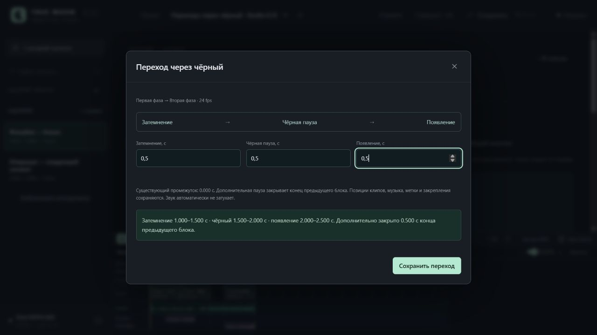
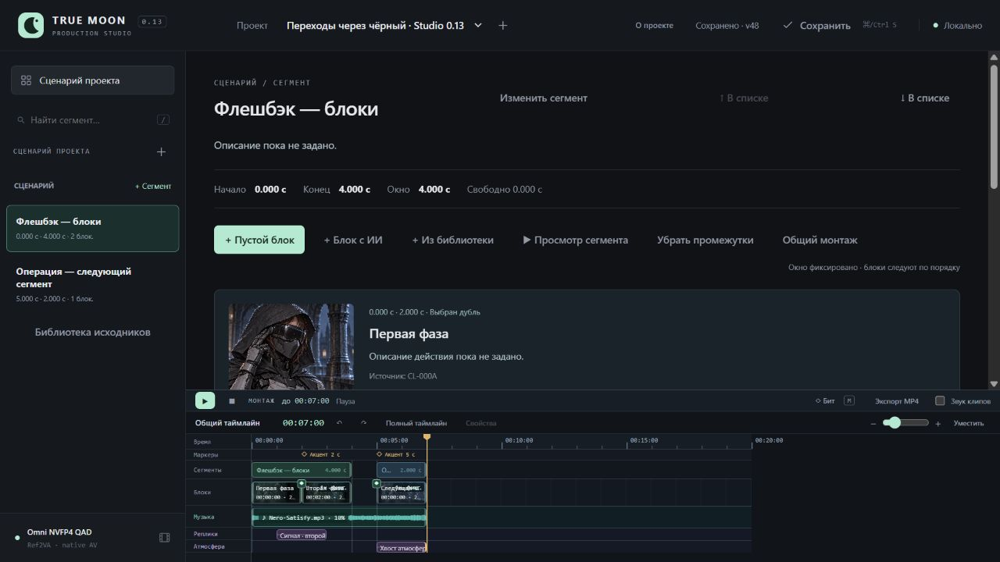

# Studio 0.13 / UI-04E — переходы через чёрный

31.10.2026. [Инструкция](../BlackTransitions.md), [машинные результаты](BlackTransitions.v1.Checks.json). Переходы занимают существующее время; клипы/сегменты/музыка/маркеры/закрепления/звук не перемещаются.

## Реальный UI → MP4

Изолированный transitions-qa, собственный сервер 8800, браузер 1280×720. Три использования CL-000A: 0–2, 2–4, 5–7 с в двух сегментах. Маркеры и закрепления — на 2 и 5 с. Музыка Nero с 44 с источника на 0–7 с и прежние два звуковых события. Авторские проекты Клэр/опенинга сохранили SHA256; рабочий сервер 8787 не менялся, GPU/ComfyUI не запускались.

Через контекстное меню стыка блоков сохранены fade-out/pause/fade-in **0,5/0,5/0,5 с**: фазы 1–1,5 / 1,5–2 / 2–2,5. Через Shift+F10 на стыке сегментов сохранены **0,25/1,25/0,25 с**: 3,5–3,75 / 3,75–5 / 5–5,25. В первом случае пауза закрывает 0,5 с предыдущего блока, во втором использует существующий промежуток 1 с и закрывает ещё 0,25 с. Все прежние размещения/источники/скорости/маркеры/музыка/звуки и библиотека совпали с исходными.

Проверены undo/redo, удаление перехода через меню и undo. Два перехода восстановились, revision 42 → 48. В реальном браузере выполнена перемотка на 1,25/1,75/2,125/3,625/4,5/5,125 с: DOM-уровень яркости и opacity чёрного слоя совпали с расчётом до 1e-6. Полное воспроизведение завершилось на 7,000 с, посещены все три клипа и промежуток.

Кнопкой экспорта создан export-72236eff9de74a9e: **7,000 с, 168 кадров, 24 fps, 896×516, H.264/AAC**, worker **2,281 с**. После перезапуска сохранились два перехода, v48 и единственный готовый MP4, повторного рендера нет. Попытка установить 0,5 с паузы на существующем промежутке 1 с показала ошибку и отключённое сохранение. Console error/warn — 0. Собственные сервер/вкладка закрыты после проверки.

## Сопоставление изображения и звука

Node сохранил настоящие frontend placementAt/transitionLevel для всех 168 кадров. Независимый PyAV/Pillow-декодер выбрал исходные кадры по PTS, применил указанные уровни и сравнил миниатюры 64×37 результата. Код export_worker при построении эталона не использовался.

| Проверка | Результат |
|---|---|
| Число/время кадров | 168; каждый PTS = n/24 |
| Чёрные / ослабленные кадры | 42 / 36 |
| Чёрные кадры, MAE | 0,000 |
| Все кадры, MAE по шкале 0–255 | среднее 0,7714, максимум 1,6646 |
| Browser opacity / grid reference | 6 контрольных точек, ошибка <1e-6 |
| Звук во время fade/black/gap/incoming | корреляции 0,99815 / 0,99939 / 0,99791 / 0,99848 |
| Уровень звука против независимого микса | RMS-отношения 1,00075 / 0,99490 / 0,98889 / 0,99105 |

Музыка/звуки не затухали вслед за изображением и сохранили позиции. Различия пикселей/отсчётов ожидаемы от H.264/AAC. Это подтверждение расчётной сетки preview и цифрового результата, не побитовая идентичность живого браузерного вывода и не художественное прослушивание. Полные выборки/скрипт находятся в QA-папке; сводка включена в Checks.json.

## Автоматические проверки

Полный набор: **236 Python**, **139 Node cases + базовый script** (140 runner entries), exit 0. Новые broad-регрессии: 11 Python + 8 Node; research/plan/status и review в отдельном TEMP. Pairing prerequisite ранее отсутствовал, пакеты не устанавливались; процент покрытия не измерялся.

| Requirement | Evidence |
|---|---|
| Стыки/фазы/точная сетка без изменения входов | `test_global_joins_windows_and_midpoint_levels_include_cross_segment_and_preserve_inputs` |
| Пауза/бюджет/границы overlap | `test_capacity_gap_and_incoming_outgoing_touch_boundaries_are_exact` |
| Атомарность/revision/сценарные конфликты | `test_invalid_transition_and_conflict_are_atomic_and_cross_segment_touch_is_valid` |
| Prune после split/remove/reorder и undo | `test_remove_split_reorder_prune_only_broken_pairs_and_undo_restores` |
| Сокращение клипа и compaction | `test_short_duration_rejects_atomically_but_valid_compaction_keeps_pair_and_undo` |
| Реальный MP4, замедленные cached RGB и независимый звук | `test_real_cpu_export_midpoint_rgb_cached_slow_frames_black_pause_and_unmodified_audio` |
| Сегментный preview межсегментных фаз | `segment preview preserves compiled global incoming and outgoing cross-segment envelopes` |
| Реальный renderer preview opacity/source/audio | `player blackout follows midpoint levels in video and gap while leaving media source rate and audio controls intact` |
| Форма/секунды/версия/повторное нажатие | `transition form validates seconds against gap and sends one captured revision without changing geometry` |
| Меню стыка | `join menu dispatches only transition remove or seek and keyboard never drags or selects clips` |
| Успешные команды (cwd UI) | `python -s -B -m unittest discover -s tests -q`; `node --test --test-reporter=spec tests/test_*.mjs` |

Найдена и исправлена JS-валидация malformed transitions:null/[null]. При затухании экспорт умножает исходный cached RGB каждого кадра, не накапливая затемнение на удерживаемых кадрах. Математический midpoint обеспечивает одинаковые значения на сетке fps у браузера и экспортера.

