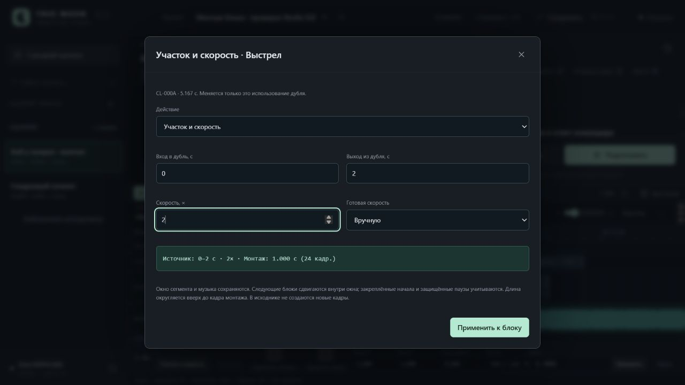
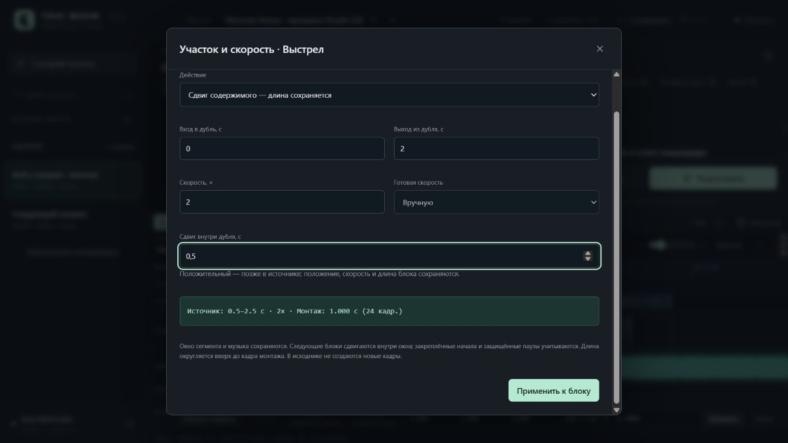
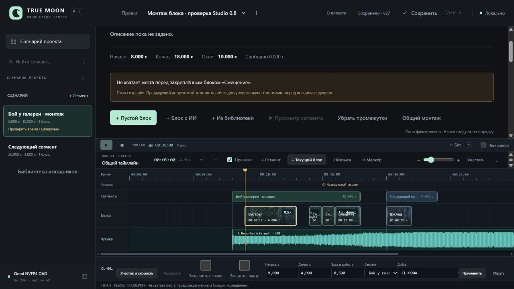

# Studio 0.8 / UI-04C — монтаж клипов

31.10.2026. Реализованы участок/постоянная скорость, сдвиг содержимого, разрезание по курсору, уплотнение сегмента, закрепление начала и защита пауз. [Инструкция](../ClipEditing.md), [машинные результаты](ClipEditing.v1.Checks.json).

## Реальная проверка

Использован отдельный QA-проект clip-qa и собственный loopback-сервер 8795. Legacy-монтаж: сегмент 8–18 с, три двухсекундных использования существующего CL-000A на 9/12/15 с; следующее окно 20–24 с, музыка и маркер на 15 с. Рабочий сервер 8787 и авторские проекты не изменялись. Viewport 1280×720 без override.

1. «Убрать промежутки» из карточки сегмента дала начала 9/11/13 с, оставив первое начало 9 с, окно 8–18 с и 3 с в хвосте. Одно ↶ восстановило исходные 9/12/15, включая legacy без scenario.
2. Через «Участок и скорость» первый clip получил источник 0–2 с при 2×: длина 1 с. В режиме сдвига содержимого +0,5 с источник стал 0,5–2,5 с при прежних 2×/1 с. Следующие блоки последовательно сдвинулись внутри окна.
3. Второму клипу заданы точные вход/выход 2–3 с; UI показал 1 с. Одно ↶ восстановило прежний участок/длину. На курсоре 12 с «Разрезать» создала две части по секунде, с точными соседними источниками 1,5–2,5 / 2,5–3,5 с, одним source/take и новым ID использования.
4. У «Смещения» закреплено начало 14 с; перед «Снижением» защищена пауза 1 с. Вторая часть разреза получила обычную паузу 0,5 с и начало 12,5. Уплотнение убрало её, вернув 12,0; защищённая секунда и якорь 14 с сохранились. Undo/redo восстановили 12,5 / 12 одним действием, без сдвига окна/музыки.
5. Замедление первого клипа до 0,5× потребовало лишнего места перед якорем. UI сохранил конфликт anchor_overlap, прежнюю допустимую сборку и заблокировал просмотр. Отмена восстановила допустимый план.
6. В сегментном плеере на 9,5 с первый клип показал source time 1,5 с и native playbackRate=2. При воспроизведении: 9,510 → source 1,520, rate 2, paused=false, buffer ticks 0, resyncs 0, max native drift 0,075 с. Музыкальные часы оставались общими.
7. Затем левая часть второго клипа замедлена до 0,5×: источник 1,5–2,5 с занял 2 с, правая часть стала на 13 с, закреплённый следующий клип остался на 14 с. При перемотке 12 с соответствовали source 2,0 с/rate 0,5. В воспроизведении 12,010 → source 2,005, rate 0,5, paused=false; buffer ticks/resyncs 0. Это проверка браузерного preview, не финального кодирования.
8. Сервер остановлен и запущен с тем же state-dir. После reload восстановлены revision 29, четыре блока первого сегмента, скорости 2×/0,5×, вход/выход 1,5–2,5 и закрепление 14 с. Browser console warnings/errors отсутствуют.

Итоговые начала/длины: 9/1, 11/2, 13/1, 14/2 с; первое окно остаётся 8–18 с. На таймлайне видны значения скорости, защита паузы и закрепление. Библиотечные blocks/assets, отборы, музыка, маркер и соседнее окно совпали с baseline. SHA256 обоих производственных Studio.project.json Клэр/опенинга сохранены. Нет GPU Jobs и копирования/перегенерации медиа.

## Автоматические проверки

Полный чистый прогон: **196 Python за 20,714 с, 99 Node, исходный JS logic PASS; exit 0**. Добавлено 17 Python и 14 Node. AST Python, node --check всех static/*.js, git diff --check и ссылки новой документации проверены.

| Требование | Прямая проверка |
|---|---|
| Скорость и участок выбранного использования | `test_edit_source_adopts_legacy_ripples_one_fixed_window_and_preserves_sources`; `clip editor writes source or slip with captured revision and suppresses pending duplicate submit`; реальный 2×/0,5× |
| Сдвиг содержимого без изменения времени | `test_slip_keeps_duration_rate_and_positions_and_rejects_source_overrun_atomically`; реальный +0,5 с к обеим границам |
| Разрез и одна отмена | `test_retimed_split_preserves_exact_span_ids_source_and_one_undo`; `split availability follows the live cursor and respects both boundaries and pending state`; разрез в UI на 12 с |
| Удаление промежутков с защитой | `test_compact_respects_first_gap_protection_anchor_and_tail_without_moving_neighbors`; реальное уплотнение/undo/redo |
| Конфликт вместо сдвига акцента | `test_anchor_conflict_preserves_last_valid_projection_and_group_move_shifts_anchor`; замедление с anchor_overlap в UI |
| Согласованность плеера/данных | helper/player cases проверяют fractional endpoints, source tail, rate/reset, музыкальные часы и signature; браузерные значения источника/скорости выше |

Набор проверяет границы 0,25/4, нечисловые/бесконечные/bool значения, пределы источника, дробный split, отсутствие мутации входов, explicit CPU metadata probe и его атомарность при ошибке, старые схемы/undo, защёлки/паузы и сохранение частичного out при правке только описания. Формы проверяют pending, revision/conflict и поздний ответ после смены проекта/модалки.

В ходе QA исправлена доступность кнопки разреза: она обновляется при движении курсора без пересоздания формы. Существующий регрессионный тест сохранил конкретное сообщение о выходе за длину дубля. Skill assertion/gap review выполнен; static pairing вызван один раз, заблокирован отсутствующим tree-sitter-language-pack. Пакеты и GPU не использовались; процент покрытия не измерялся. Fake media/form не заменяет браузерные проверки выше.

Команды из корня книги:

```powershell
& 'E:/ComfyUI_windows_portable/python_embeded/python.exe' -s -B -m unittest discover -s TrueMoonTales/AMV/UI/tests -p 'test_*.py' -q
node TrueMoonTales/AMV/UI/tests/test_logic.mjs
$studioJsTests = Get-ChildItem TrueMoonTales/AMV/UI/tests -Filter 'test_*.mjs' | Where-Object Name -ne 'test_logic.mjs' | ForEach-Object FullName
node --test --test-reporter=spec $studioJsTests
```

Переменная скорость, новые интерполированные кадры, регулируемая вертикальная компоновка, типы/иконки сегментов, дополнительные дорожки, переходы/титры и экспорт не объявляются готовыми. Ближайший функциональный шаг — черновой экспорт текущей сборки с проверкой времени/скорости. Собственный сервер 8795 и тестовая вкладка после проверки закрыты.






