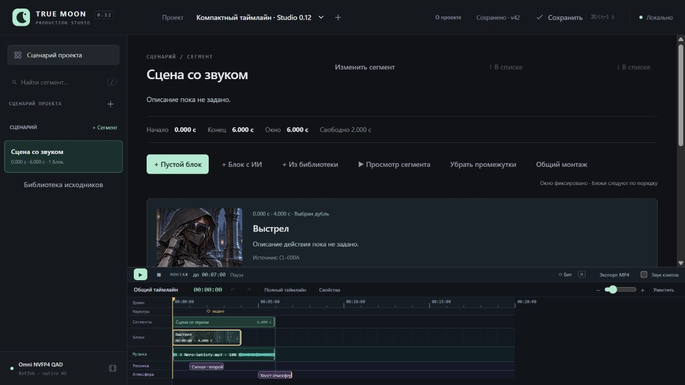

# Studio 0.12 — компактный вид в карточке сегмента

31.10.2026. [Инструкция](../CompactTimeline.md), [машинные проверки](CompactTimeline.v1.Checks.json).

Изолированный layout-qa, собственный сервер 8799, браузер 1280×720. Исходный тестовый проект: одна карточка/клип, маркер на 2 с, музыка и две звуковые дорожки. GPU/ComfyUI не запускались. Рабочий сервер 8787 не менялся. SHA256 авторских проектов и всего Studio.project.json тестового проекта совпали с исходными: изменение плотности/настроек вида не записывает монтаж или историю, revision осталась 42.

## Визуальная проверка

| Область | Компактный режим | Полный режим |
|---|---:|---:|
| Таймлайн | 220,67 px | 452,67 px |
| Сценарная область | 434,33 px | 202,33 px |

Карточка получила **232 px** дополнительной высоты. Линейка/маркер/сегмент/клип/музыка и обе звуковые полосы видны; последний ряд заканчивается на 708 px, шкала остаётся в окне до 720 px. Волна музыки рисуется в низком canvas, не обрезается старой высотой. Превью не перенастраивается.

Проверены кнопки полного/компактного вида, свойства выбранного клипа с открытием/закрытием, правый клик/Escape, переход к материалам блока и обратно. Редактор первоначально открылся в полном режиме. Его прежнее сворачивание не скрыло дорожки при возврате в компактную карточку. Затем сохранены разные явные виды для двух контекстов: full для карточки, compact для редактора; возврат к карточке восстановил full. После обновления страницы сохранился выбранный вид. В конце карточка снова переведена в compact; повторный reload показал context=story, density=compact и видимые дорожки.

Console error/warn — 0. Собственный сервер/вкладка закрыты после QA. Проверка относится к 1280×720; регулируемая граница и дополнительные пресеты не объявляются реализованными.

## Проверки поведения

Полный набор: **225 Python**, **131 Node cases + базовый script** (132 runner entries), exit 0. Для плотности/состояния/волны добавлены 7 focused Node cases. Подмена DOM/canvas в узких тестах дополняется визуальным QA выше; новые пакеты не устанавливались.

| Requirement | Evidence |
|---|---|
| Компактная карточка, полный редактор | `timeline density defaults to visible compact story and full editing` |
| Раздельные UI-ключи и сохранение | `density preferences persist independently of project in two context keys` |
| Недоступный localStorage | `storage failures keep layout usable without a migration or project write` |
| Старое сворачивание не скрывает компактную шкалу | `view restores context preference and prevents inherited collapse from hiding compact lanes` |
| Курсор/масштаб/выбор/проект сохранены | `density change only alters UI and preserves cursor zoom selection and project` |
| Свойства по выбору элемента | `compact properties controls follow selection and context without editing montage` |
| Волна в границах низкого canvas | `music waveform stays visible and inside the canvas in both timeline densities` |
| Успешные команды (cwd UI) | `node --test tests/test_timeline_layout.mjs`; `node --test --test-reporter=spec tests/test_*.mjs`; `python -s -B -m unittest discover -s tests -q` |

В тестовой canvas-модели добавлен отсутствовавший dataset. Настройки вида хранятся отдельно от проекта; никаких новых серверных операций/полей монтажа нет.

