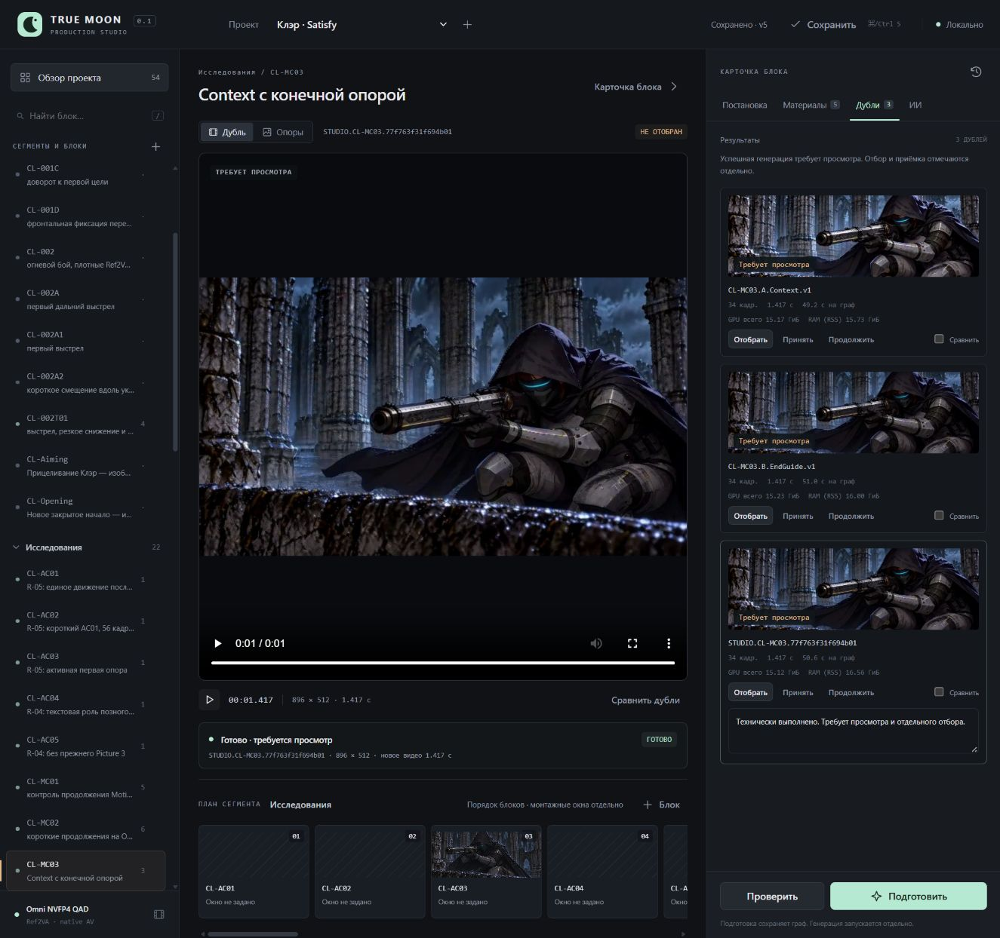
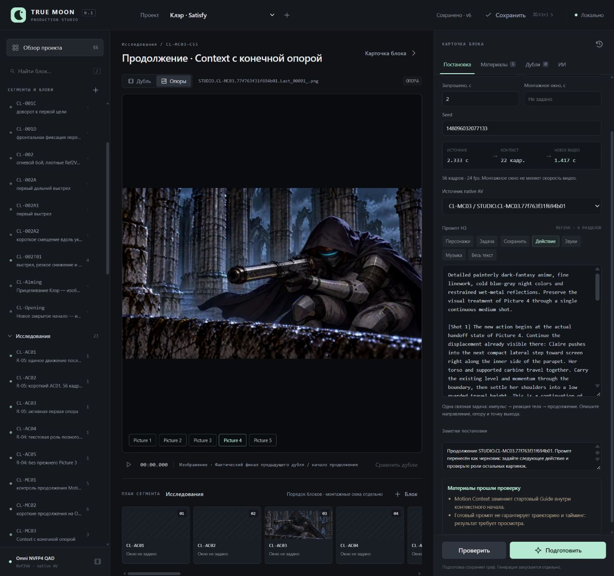

# UI-02 — один контрольный дубль через Studio

30.10.2026. Выполнено по прямому запросу автора: подготовка и запуск через UI, сохранение результата, показ метрик и создание продолжения Motion Context. Один GPU-дубль; продолжение не генерировалось и в монтаж ничего не принималось.

## Итог

**Путь Studio → API Omni.v1.1 → GPU → collect → просмотр/метрики → черновое продолжение подтверждён.** Новый результат и продолжение сохранились после перезапуска Studio; повторной подачи нет. Это работа из нового UI приложения, а не ручной запуск в редакторе native ComfyUI workflow.

- Проект Клэр: revision 4 → 5 при добавлении дубля → 6 при создании продолжения.
- Задание: `job-77f763f31f694b01`, имя `STUDIO.CL-MC03.77f763f31f694b01`.
- Новый дубль: `take-46963dc53f644a94`, состояние `unreviewed`, автоматического отбора/приёмки нет.
- Продолжение: **CL-MC03-C55**, ID `block-e561adbfd4064fda`, `context`, `draft`, без дублей и заданий.
- [Машинная проверка: 23 условия](Control.Run01.Checks.json), [состояние задания](../../Clair/Production/Jobs/job-77f763f31f694b01/Studio.job.json), [Result.json ядра](../../Clair/Production/Jobs/job-77f763f31f694b01/Run/Result.json).

## Условия и показатели

Реальный блок CL-MC03 с двумя Guides и исходным Gallery A из MC02. Пять прежних изображений, точный промпт и seed 148096032077132 сохранены; сюжет и музыкальная сетка не менялись. POV внешний, неподвижный средний план; задача — продолжить низкое смещение вправо вдоль парапета, удерживая сектор карабина. Якоря — камень, колонны, оружие. Проверяется работа UI и связей, а не новая постановка.

Omni NVFP4 QAD / Qwen NVFP4 AWQ, native AV, прежние VAE, res_multistep/simple, 8 шагов, Sage, 896×512, 24 fps, без звука. Duration 2.0 → 56 Raw / 2,333 с; context trim 22 → 34 New / 1,417 с.

| Показатель | Факт |
|---|---|
| Полный граф | 50,551 с |
| Solver / conditioning | 30,731 / 11,444 с |
| UI launch → collect | 76,525 с, включая предзапуск/загрузку/сбор |
| Пик общей VRAM | 15,124 ГиБ, включает другие приложения |
| Пик RAM процесса (RSS) | 16,558 ГиБ |
| Sage / SDPA | 400 / 0 |
| H3 forward | 8; все video/audio выходы finite |
| Подачи в очередь | 1, статус success |
| Cleanup | Собственный сервер остановлен, exit_code 0; порт 8199 свободен |

В UI добавлено отображение пиков общей VRAM и RAM (RSS) рядом со временем графа; значения берутся из сохранённого результата, не рассчитываются по размеру модели.

## Файлы и проверка просмотра

- [New MP4, 34 кадра](../../Clair/Production/Jobs/job-77f763f31f694b01/Run/output/video/STUDIO.CL-MC03.77f763f31f694b01.New_00001_.mp4).
- [Raw MP4, 56 кадров](../../Clair/Production/Jobs/job-77f763f31f694b01/Run/output/video/STUDIO.CL-MC03.77f763f31f694b01.Raw_00001_.mp4).
- [Последний PNG](../../Clair/Production/Jobs/job-77f763f31f694b01/Run/output/frames/STUDIO.CL-MC03.77f763f31f694b01.Last_00001_.png).
- Native AV: `Run/output/latents/STUDIO.CL-MC03.77f763f31f694b01_00002.safetensors` — парные video/audio, 2 948 568 байт; точный путь/хэш в Checks.

Оба MP4 полностью декодированы PyAV, размеры/fps/число кадров/отсутствие аудио совпадают с Result. Хэши всех четырёх выходов совпадают. PNG 896×512. В браузере выбран именно новый дубль, New воспроизведён до конца: duration/currentTime 1,416667, ended=true, media error отсутствует. UI показывает 3 дубля MC03 и измеренные показатели. Детальная художественная приёмка этим не выполняется.

## Продолжение

Кнопка «Продолжить» нажата у нового дубля. Создан CL-MC03-C55 с `context_take_id=take-46963dc53f644a94`, seed 148096032077133 и прежним размером. Picture 4 заменён точным сохранённым PNG; единственный Guide — этот референс, frame 0. Старый конечный Guide снят. Контекст берётся из парного native AV того же дубля. Картинки загружаются, техническая проверка не находит ошибок.

Промпт перенесён как черновик: до следующей генерации нужно определить новое действие, выход и роль оставшегося семантического Picture 5. Прежний желаемый финал остаётся семантической картинкой, но уже не назначен последним Guide. Создание черновика не подтверждает пригодность прежней формулировки для следующей фазы.

После перезапуска приложения повторно открыты сохранённые блок, источник native AV и дерево с тремя дублями MC03/новым продолжением. Заданий у CL-MC03-C55 нет; GPU после исходного контрольного дубля не запускался.

## Исправление, выявленное контрольным проходом

Первая UI-попытка `job-3aa92639f2214822` завершилась **до Submission и запуска сервера/GPU**. Port.prelaunch.json подтверждает ready, но Windows PowerShell 5.1 вернул пустой ExitCode для Start-Process с перенаправлением логов после timed wait, из-за чего runner отказал в старте. Диагностика не удалялась.

[CPU-проба](Probe.PowerShell.ps1) воспроизвела различие на пустом Python-процессе: PS 5.1.26100.9818 — ExitCode=null; PS 7.6.9 — 0. UI теперь использует установленный PowerShell 7 и проверяет его наличие до подготовки; никакая проверка порта или повторной подачи не обходилась. Для рабочего дубля выполнена новая явная подготовка/отправка. Единственный Submission среди заданий Studio относится к успешному job-77f763f31f694b01.

**54 unittest — OK, 3,351 с**, JS logic — PASS, синтаксис app.js проверен. Два добавленных теста: `test_missing_powershell7_refuses_preparation_before_job_creation`, `test_worker_uses_powershell7_with_bounded_wait_and_literal_job_path`. Они проверяют границу запуска без GPU. Реальное выполнение подтверждено отдельно перечисленными артефактами, не этими имитациями.

## Открытые проверки

Принудительная остановка специально зависшего GPU, восстановление во время исполнения, длинная цепь и генерация CL-MC03-C55 не проверялись. Контрольный шот короткий; он не доказывает общую стабильность всех профилей/оборудования или улучшение динамики. MCP/встроенный ИИ, монтаж и экспорт остаются последующими этапами.

Собственный сервер предпросмотра после проверки остановлен; для работы запускать Start-Studio.cmd. Watchdog и таймеры сохранены; в этом успешном проходе аварийно вмешиваться не потребовалось.
