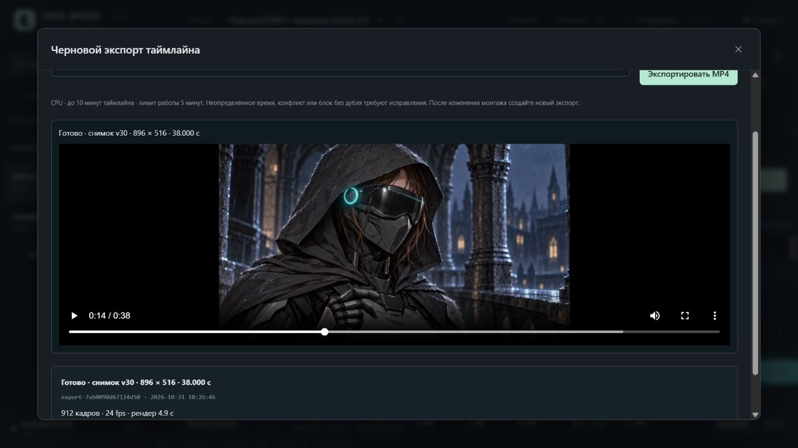

# Studio 0.9 / UI-04D — черновой экспорт MP4

31.10.2026. Реализован экспорт всего таймлайна с выбранными дублями/участками, постоянной скоростью, чёрными паузами, музыкой и включённым исходным звуком. [Инструкция](../DraftExport.md), [машинные результаты](DraftExport.v1.Checks.json).

## Сквозная проверка через UI

Собственный сервер 8796, изолированный проект export-qa в `UI/.local/export-qa-20261031-r1/`, браузер 1280×720 без override. Авторские проекты Клэр и опенинга и рабочий сервер 8787 не редактировались. Хэши обоих Studio.project.json совпали с исходными. Генерации ComfyUI/GPU и установки пакетов не выполнялись.

Монтаж: два окна 8–18 и 20–24 с; пять использований CL-000A, скорости 2×/0,5×/1×, разные входы/выходы, разрезанный клип, защищённая пауза и закрепление на 14 с. Музыка Nero-Satisfy: начало в проекте 8 с, источник с 44 с, длина 30 с, gain 0,3. Поэтому общий экспорт длится 38 с с чёрным началом, паузами и хвостом. «Звук клипов» включён через UI до создания снимка v30.

1. «Экспорт MP4» → черновой профиль → «Экспортировать MP4». Создан export-7ab0090d67124d50, running → completed; H.264/AAC, **896×516, 24 fps, 912 кадров, 38,000 с**, работа worker **4,938 с**. Это время конкретного короткого монтажа с большим числом чёрных кадров, не прогноз для насыщенного фильма.
2. «Смотреть MP4»: метаданные, воспроизведение и ручная перемотка на ~14,86 с работают. Монтажный плеер остаётся на паузе; пробел в модальном окне не запускает его поверх звука MP4. Обновление списка не пересоздаёт просмотр. «Скачать MP4» ведёт на сохранённый файл с Range/HEAD.
3. Повторное явное создание даёт новый ID export-c733300b5d3d481d; немедленная «Остановить экспорт» переводит его через stopping в cancelled. Частичный результат не доступен как готовое видео; предыдущий MP4 сохранён.
4. Собственный сервер остановлен и запущен заново. В UI сохранились completed/cancelled, MP4 открывается; число экспортов осталось 2. Проект сохранил revision 30, равную снимку. Автоматических повторов нет. Сервер и вкладка QA после проверки закрыты.

## Сопоставление с предпросмотром

Для каждого из **912** времён `frame / 24` сохранён результат настоящей frontend-функции `static/playback-logic.js: placementAt`. Независимый QA-декодер выбирает native кадр по его PTS и сравнивает с результатом; функция расчёта source time экспортера при построении эталона не использовалась.

| Проверка | Результат |
|---|---|
| Число и PTS выходных кадров | 912, каждый PTS равен n/24 |
| Контент и чёрные интервалы | 192 / 720 кадров, все склейки на ожидаемых границах |
| Сравнение миниатюр 64×37, MAE по шкале 0–255 | Среднее 1,042, максимум 1,314; чёрные кадры 0,000 |
| Музыка 8,25–8,75 с результата ↔ 44,25–44,75 с источника | Корреляция 0,9932; лучший сдвиг 0 отсчётов при 48 kHz |
| Громкость после AAC при gain 0,3 | RMS-отношение 0,2957; ожидаются потери кодека |
| До начала музыки | Максимальный отсчёт 0,000 на проверенном интервале 0–7,9 с |

Сравнение подтверждает **расчётную сетку preview**, участки/скорость, склейки и музыкальный offset. H.264/AAC меняют байты, а браузерный live preview может задерживаться. Это не обещание побитового совпадения. AAC-декодер вернул 768 дополнительных padding-отсчётов (16 мс) после номинальных 1 824 000; длительность контейнера и видео — ровно 38 с, музыкальная опора не сдвинулась. Независимый скрипт и выборки сохранены в QA-папке; сводные метрики включены в Checks.json.

## Автоматические проверки

Полный набор прошёл: **213 Python**, **105 Node cases + базовый JS script** (106 entries при общем node --test). Дополнительно AST 37 Python-файлов и node --check 15 static JS. Ниже exact test names; вспомогательный real-render тест создаёт крошечный CPU MP4, без видеомодели.

| Requirement | Evidence |
|---|---|
| Участки, скорость, точные кадры, letterbox, чёрные паузы, музыка/тишина | `test_tiny_real_mp4_has_exact_frames_floor_retime_letterbox_gaps_music_trim_gain_and_silent_native` |
| Native звук: tempo и границы, изменение исходника | `test_native_audio_tempo_chains_and_sample_boundaries_and_source_mutation_rejection` |
| Снимок только для чтения, размеры обоих профилей | `test_plan_is_detached_read_only_with_draft_even_size_and_exact_project_profile` |
| Музыкальный хвост, пустое окно, маркер и граница 600 с | `test_extent_includes_empty_segment_and_music_tail_but_not_markers_and_accepts_600_seconds` |
| Остановка только своего worker и внешний timeout | `test_process_stop_ownership_requires_pid_creation_script_and_exact_job_folder`; `test_monitor_timeout_terminates_owned_worker_and_cannot_report_completed_without_video` |
| Долговечная идемпотентность за пределами списка из 50 | `test_durable_retry_finds_original_key_beyond_fifty_row_display_limit` |
| HTTP token/revision, неизменность проекта/генерационных Jobs | `test_export_routes_enforce_token_revision_and_list_status_without_project_or_generation_changes` |
| Completed-only MP4, Range/HEAD | `test_result_video_is_unavailable_until_completed_then_range_and_head_match_bytes` |
| UI: явная отправка, сеть, повтор и новый ключ | `export form performs no automatic POST and keeps retry key on network failure renewing only after success` |
| UI: остановка со свежей версией и защита смены проекта | `export stop reads latest status revision before POST and late project response cannot stop old task` |
| Legacy без timeline не требует миграции | `export dialog opens for legacy project without timeline without writing a migration` |
| Полный успешный прогон | `python -s -B -m unittest discover -s tests`; `node --test tests/test_*.mjs` (cwd UI, exit 0) |

При проверке исправлены поиск client key старше последних 50 записей, открытие пустого legacy-проекта без timeline и управление паузой при просмотре MP4. Test-quality review выполнен; static pairing однажды был недоступен из-за отсутствующего tree-sitter-language-pack, пакеты не устанавливались. Процент покрытия не измерялся.

Плавные переходы, титры, дополнительные дорожки, speed ramp и финальный мастер остаются открыты. Следующий функциональный этап — UI-08A, звук сегмента.

