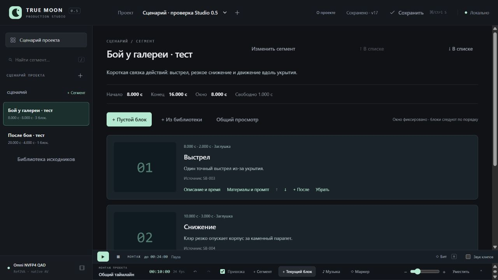
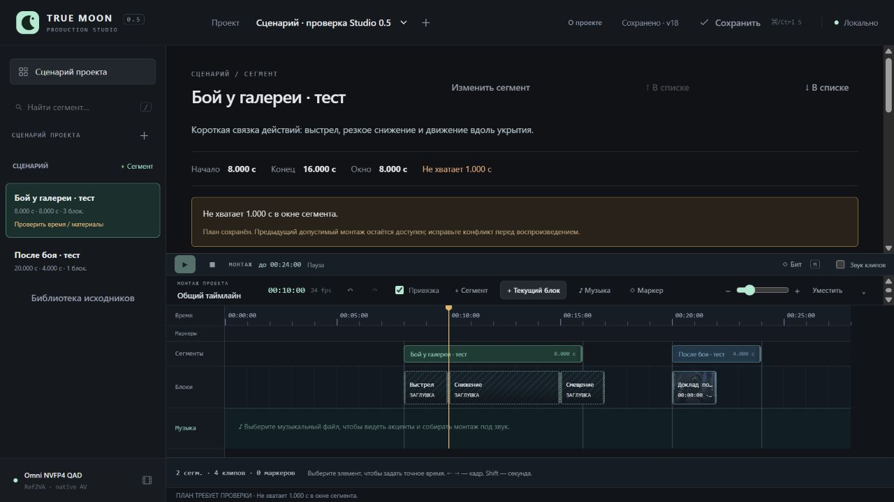

# Studio 0.5 / UI-06A — сценарные сегменты и блоки

31.10.2026. [Инструкция](../Scenario.md), [результаты JSON](Scenario.v1.Checks.json).





## Результат

Реализован первый согласованный этап UI-06A: сегменты и блоки с названиями, отдельными сценарными описаниями, известным/неизвестным временем, паузами и упорядочиванием. Время вычисляется последовательно внутри фиксированного окна. Свободное время и конфликты показываются явно. Канонические намерения хранятся в timeline.scenario; допустимая монтажная проекция обновляется атомарно. При конфликте намерение сохраняется вместе с последним допустимым монтажом; видео не ускоряется и не обрезается автоматически.

Начальный рабочий экран теперь сценарный: боковая панель сегментов, центральная карточка с блоками, добавление пустого блока/использования из библиотеки, описание/время, выбор дубля и переход к существующему редактору материалов/промпта. Библиотека исходников сохранена отдельно. Текст сценария не переписывает H3-промпт или заметки дублей. Удаление/отмена не удаляет исходники.

## Проверка в браузере

Отдельный проект scenario-qa в UI/.local/scenario-qa-20261031-r1/, собственный сервер 8792; производственный экземпляр не останавливался.

1. Через UI создан сегмент 8–16 с с описанием и три пустых блока: «Выстрел» 2 с, «Снижение» 3 с, «Смещение» 2 с. Карточка и таймлайн показали входы 8 / 10 / 13 с и свободную 1 с. Для заготовок созданы draft-источники без запуска подготовки/генерации.
2. Длина среднего блока изменена на 5 с. Карточка показала нехватку 1 с, таймлайн — плановый выход за конец окна. В persisted actual timeline сохранился прежний допустимый участок 3 с; плановая длина осталась 5 с. Общий play заблокирован. Undo вернул длину 3 с, положение последнего блока 13 с и свободную секунду.
3. Через форму самого таймлайна средний блок изменён с 3 на 4 с. Карточка отразила 8 / 10 / 14 с, свободное время 0 с и прежний конец 16 с. Undo восстановил начальную раскладку.
4. Создан второй сегмент 20–24 с. Новое переполнение первого оставило второе окно 20–24. В него добавлено библиотечное использование CL-000A длительностью 2 с; в форме явно назначен существующий дубль, недостающие метаданные прочитаны на CPU. Source review_state не менялся автоматически.
5. Библиотека показала прежние CL-000A/MC03 и новые заготовки; «Материалы и промпт» открывает исходный редактор. Возврат к сценарию доступен через панель. Формы начала/конца/окна согласованы: начало 10 с при длине 8 с показывает конец 18 с.
6. Созданы сегмент и блок без назначенного времени. UI показал «Требуется расчёт», «Позиция не определена», «Длина не задана». Сегмент убран из сценария, его draft-источник остался в библиотеке. Итоговая библиотека содержит 6 источников, сценарий — 2 сегмента/4 использования.
7. Общий просмотр от 20 с прошёл назначенный видеоклип и чёрный хвост, остановившись на 24 с. Считывание DOM: video → gap, 2 проверки загрузки при старте, 0 восстановительных перемоток; максимальное native video drift 0,1284 с. Это браузерный preview с прежними ограничениями декодирования, не проверка финального экспорта.
8. Собственный сервер остановлен и запущен повторно. После reload восстановились два сегмента, три карточки первого, окно 8–16 и свободная 1 с; revision 19. Console warning/error после reload отсутствуют. Реальный viewport 1280×720; для обзорного снимка таймлайн свёрнут штатной кнопкой, без изменения viewport.

В QA нет Production/Jobs: GPU-запусков и подготовки ComfyUI не было. SHA256 производственных Studio.project.json Клэр и опенинга совпали с baseline начала этой проверки. Исходные видео/иллюстрации не изменялись; работа выполнена в коде/документации UI и отдельном QA-проекте.

## Проверки

Чистый полный прогон: **165 Python за 15,536 с, exit 0; 50 Node, exit 0; исходный JS logic script PASS**. Новая часть — 22 Python и 10 Node. Python AST, node --check изменённых JS и git diff --check пройдены. Пакеты не устанавливались.

| Требование | Прямая проверка |
|---|---|
| «Сохранять окно сегмента; блоки внутри сдвигать последовательно» | `test_duration_and_explicit_gap_edits_ripple_items_inside_fixed_window`; `known story gaps and duration ripple preserve source ids and fixed segment window`; реальная правка 3 → 4 с из таймлайна |
| Остаток/переполнение без потери монтажа | `test_overflow_one_frame_persists_intent_without_truncating_last_valid_projection`; `test_post_returns_full_project_actor_revision_and_issue_persists_last_valid_projection`; UI 7/8 и 9/8 с |
| Неизвестное время и отдельные текстовые заготовки | `test_unknown_item_duration_propagates_unknown_positions_and_null_window_is_unplaced`; `test_blank_item_creates_draft_source_and_remove_and_undo_never_delete_it` |
| Сохранность прежней структуры/источников | `test_legacy_get_is_read_only_adopts_only_placed_items_and_preserves_ids_gaps`; `test_library_add_is_new_usage_and_explicit_take_binding_preserves_source_selection` |
| Общие операции сценария/монтажа и история | `test_translate_only_applies_to_active_scenario_and_duration_edits_ripple`; `test_spatial_move_reorders_once_and_left_trim_adjusts_gap_without_shifting_next_end`; `test_undo_redo_preserve_later_prompt_take_assets_and_clear_legacy_scenario` |
| Работа агента и сохранность черновика | `test_cli_scenario_round_trip_is_real_local_http_without_automatic_generation`; `scenario dialog explicit revision is retained and concurrent writes are rejected`; `project change during flush aborts before API and late response never applies to new project` |

Дополнительно проверены реальные границы/соседние значения, malformed schema/order, неизменность исходного аргумента, недопустимые окна, короткий дубль и отсутствие metadata без декодирования на GET, паузы при добавлении из таймлайна, очистка legacy scenario при undo, сохранение последующих промптов/takes/assets. Assertion/gap review выполнен. Обязательный pairing вызван, но заблокирован отсутствующим tree-sitter-language-pack; зависимость ради него не устанавливалась. Процент покрытия не измерялся.

```powershell
& 'E:/ComfyUI_windows_portable/python_embeded/python.exe' -s -B -m unittest discover -s TrueMoonTales/AMV/UI/tests -p 'test_*.py' -q
node TrueMoonTales/AMV/UI/tests/test_logic.mjs
node --test TrueMoonTales/AMV/UI/tests/test_timeline_logic.mjs TrueMoonTales/AMV/UI/tests/test_timeline_view.mjs TrueMoonTales/AMV/UI/tests/test_playback_logic.mjs TrueMoonTales/AMV/UI/tests/test_montage_player.mjs TrueMoonTales/AMV/UI/tests/test_agent_ui.mjs TrueMoonTales/AMV/UI/tests/test_scenario_logic.mjs
```

## Границы выпуска

UI-06A готов, UI-06B выполнен только в части начальной навигации/карточки. Отдельный preview диапазона сегмента, раздельные вкладки референсов/опор, задания агенту из сценарной карточки и дополнительные дорожки из аудио/видео остаются следующими шагами. «Общий просмотр» открывает существующий просмотр проекта. При неизвестном времени или конфликте он заблокирован до исправления плана; отдельные дубли можно смотреть через редактор.

Порядок сегментов в списке редактируется отдельно от их фиксированных окон. Перенос клипа между сегментами через timeline пока возвращает явное 422; добавление библиотечного использования доступно в нужной карточке. Исходный промежуток/скорость видео меняются только явной правкой; назначение слишком короткого дубля даёт конфликт, а не скрытое растягивание. Не заявлены новые GPU-проверки, экспорт или улучшение качества движения модели.

Тестовая вкладка и собственный сервер 8792 после проверки закрыты.
