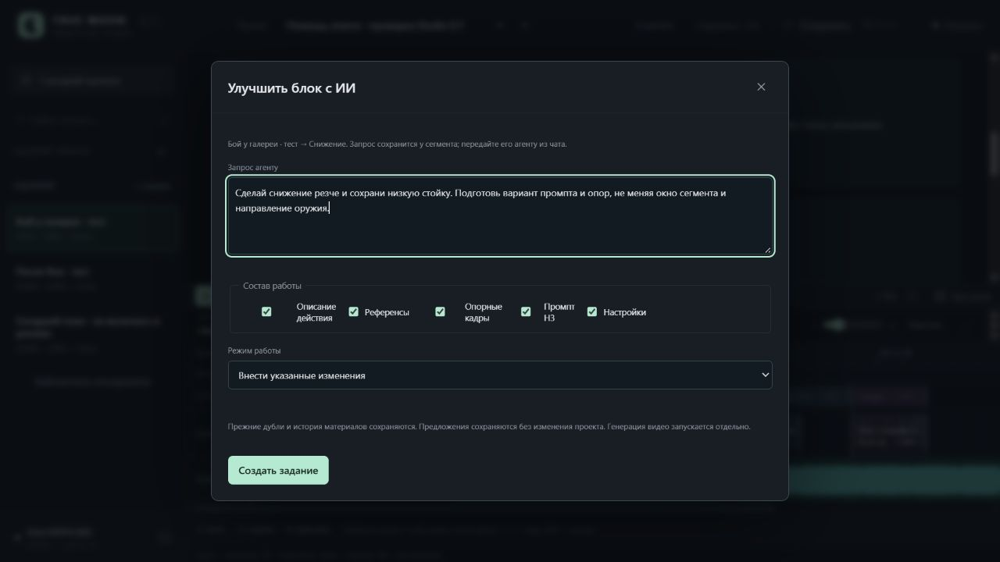
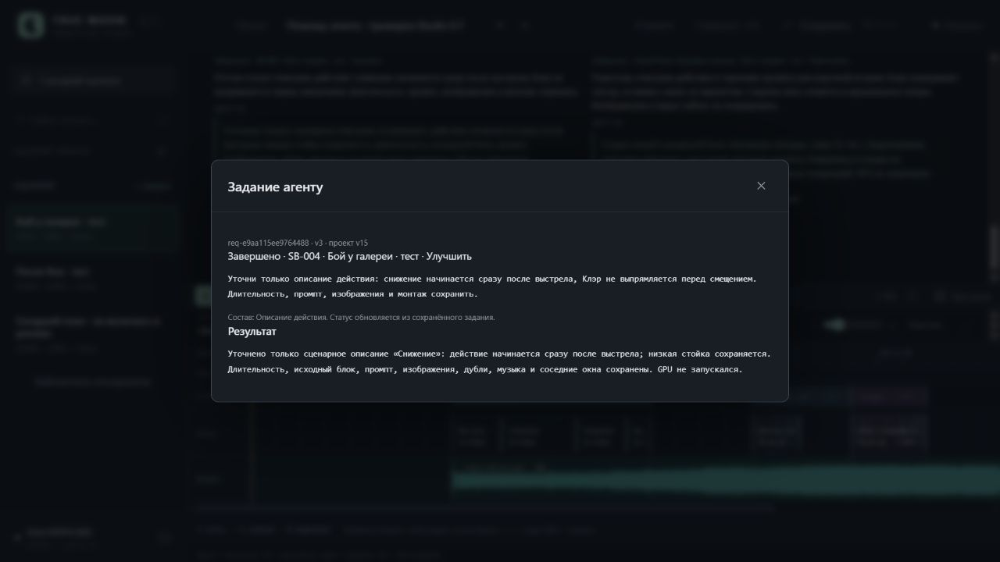

# Studio 0.7 / UI-03B — проверка сценарных заданий агенту

31.10.2026. Запрос: подготовка нового блока и улучшение существующего через агента из карточки сегмента, с вводом запроса; типы/иконки сегментов внести в план, высоту превью/таймлайна обсудить отдельно.

Реализованы формы «+ Блок с ИИ» / «Улучшить с ИИ», состав работы и режим apply/propose, сценарный scope, устойчивые связи источника/использования, контекст соседей, статусы/результаты, копирование в чат, отмена и открытие результата. Создание задания не создаёт блок или GPU-job: внешнему агенту передаётся сохраняемый запрос. Новый блок появляется после исполнения через существующий API. Автоматического вызова модели нет.

[Инструкция](../ScenarioAgent.md), [машинные проверки](ScenarioAgent.v1.Checks.json).

## Реальный цикл UI → CLI → UI

Изолированный проект agent-qa на собственном сервере 8794, копия прежнего QA с существующими источниками/дублями. Рабочий Studio на 8787 не перезапускался. Viewport 1280×720, без подмены размера.

1. Из карточки «Бой у галереи · тест» создано prepare_block-задание «Проверка сектора», длина 1 с, описание/черновик промпта. В список добавилось pending-задание, revision проекта осталась 13, сценарных блоков по-прежнему три. Копирование в чат содержит URL, ID проекта/задания, исходный запрос и контекст с предшествующим «Смещением».
2. Внешний локальный агент через studio_agent.py выполнил claim → scenario/add_item → patch-block → finish с target-file. Создан новый источник SB-007 и item на 15–16 с внутри прежнего окна 8–16 с; project revision 15, свободное время 0. UI автоматически показал четвёртую карточку и клип на таймлайне, completed-результат и «Открыть результат». Кнопка открыла материалы нужного SB-007.
3. Через «Улучшить с ИИ» у «Снижения» создан отдельный apply-запрос только на description. Контекст указал точный item/source, соседние «Выстрел»/«Смещение», source_usage_count=1. CLI изменил только описание использования и завершил с target-file. UI показал текст и результат, revision 16. Длительности, библиотечные входы генерации, дубли, музыка, маркеры и окна соседей сохранены.
4. Собственный сервер остановлен/запущен повторно. После reload восстановились четыре карточки первого сегмента и оба completed-задания с результатами и ссылками. В другом сегменте эти задания не отображаются.
5. Во втором сегменте создан propose-запрос и отменён через UI: persisted state cancelled, project revision 16 сохраняется. Результаты первого сегмента остались доступны.
6. Открыта форма нового propose-задания, введены название/запрос. Параллельная QA-правка brief увеличила revision до 17. Отправка старой формы дала 409 и сохранила поля. «Обновить контекст» прочитал свежий проект; ручная повторная отправка создала одно задание с прежним текстом. Затем оно отменено. Новый блок из предложения не создавался.

Текст нового H3-промпта в QA является техническим черновиком проверки доставки; качество видеопостановки/готовность к генерации не оценивались. Изображения и видео не генерировались. Проверенные задания не меняли авторские материалы и канон.

## Автоматические проверки

Полный прогон: **179 Python, 18,696 с, exit 0; 85 Node, exit 0; исходный JS logic PASS**. Добавлено 14 Python и 12 Node. После добавления путей изображений в соседний контекст выполнен дополнительный узкий backend-прогон. Python AST, node --check и git diff --check пройдены.

| Требование | Evidence |
|---|---|
| Подготовка нового блока из карточки с запросом | `test_prepare_and_improve_intents_only_create_tasks_and_capture_real_neighbor_snapshot`; `test_applied_preparation_finishes_only_after_external_new_item_and_links_resolved_block`; реальный UI/CLI-цикл SB-007 |
| Улучшение конкретного существующего блока | `test_result_target_respects_selected_use_not_just_shared_block_and_modes`; `scenario request DTO captures new draft or exact existing use with component subset and no mutation`; реальная правка только description |
| Контекст времени/соседей/музыки и чтение без записи | `test_scoped_context_contains_current_window_music_neighbors_and_shared_source_count_read_only`; snapshot_sha256, границы и неизменность файлов проверяются значениями |
| Повторная отправка/конфликт без потери запроса | `test_concurrent_retry_key_creates_exactly_one_durable_intent`; `409 preserves complete form draft and rebase fetches fresh revision before same-key retry`; реальный 409/rebase в браузере |
| Статусы/передача/отмена и поздние ответы | `copy includes full durable task and cancel re-reads latest revision without GPU actions`; `late view action response after leaving selected segment does not open old task` |
| Иконки/тип и компоновка — только план | [UI-UX01/UI-UX02](../Plan.md#улучшение-восприятия-и-компоновки--очередь-ux); типы не назначались, layout CSS не изменялся |

Одна ошибка выявлена и исправлена регрессией: поздний GET старого задания мог открыть модальное окно после перехода в другой сегмент того же проекта. Теперь проверяются проект, сегмент, корневой элемент и активность сценария. Проверены границы схемы/времени, неизменность входов, общий источник в двух использованиях, отсутствие target/старый target, concurrency/идемпотентность, pending/draft/rebase и совместимость старых CLI-payloads без новых null-полей.

Skill-процесс включает assertion/gap review. Static pairing вызван один раз, недоступен без tree-sitter-language-pack; пакеты не устанавливались. Покрытие в процентах не измерялось. Имитации не подменяют реальные UI/CLI-проверки выше.

Успешные команды проверки из корня книги:

```powershell
& 'E:/ComfyUI_windows_portable/python_embeded/python.exe' -s -B -m unittest discover -s TrueMoonTales/AMV/UI/tests -p 'test_*.py' -q
node TrueMoonTales/AMV/UI/tests/test_logic.mjs
$studioJsTests = Get-ChildItem TrueMoonTales/AMV/UI/tests -Filter 'test_*.mjs' | Where-Object Name -ne 'test_logic.mjs' | ForEach-Object FullName
node --test --test-reporter=spec $studioJsTests
```

## План и ограничения

В UI-UX01 внесены нейтральный/диалог/рассказ/визуальный показ/экшн и другие типы, SVG-иконки в дереве/карточке/таймлайне, чтение старых проектов и независимость от времени/канона. Окончательная схема остаётся для обсуждения.

В UI-UX02 внесены регулируемая граница, «Монтаж / Баланс / Просмотр», минимальные высоты, локальное сохранение состояния и проверка разных окон. Замер при развёрнутой шкале: timeline ~357 px, сценарная область ~298 px. Свёрнутый timeline раскрывается отдельно; уменьшение превью не раскрывает его автоматически. Текущая компоновка не менялась.

SHA256 производственных Studio.project.json Клэр/опенинга сохранены. Нет GPU Jobs и автоматической перегенерации. UI-08A, автоматический dispatch/MCP и экспорт остаются открытыми. После проверки собственная вкладка и сервер 8794 закрыты.




