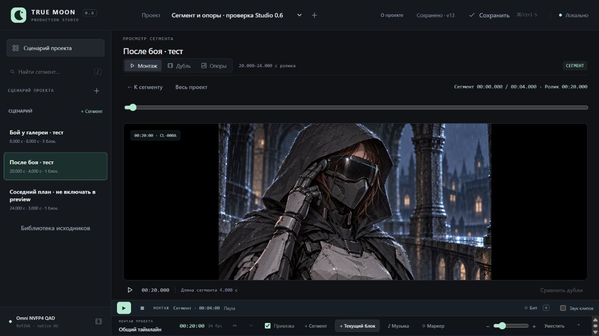
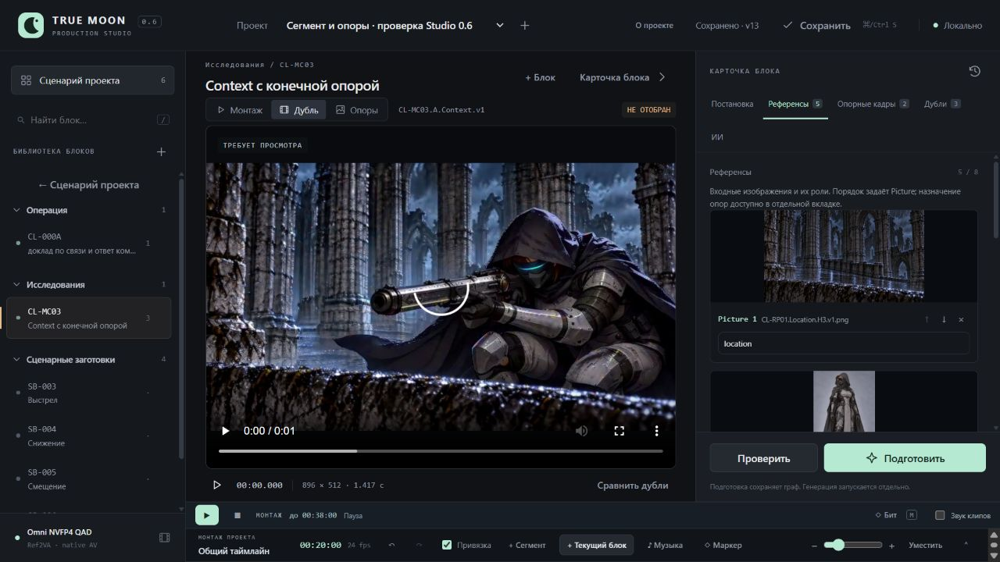
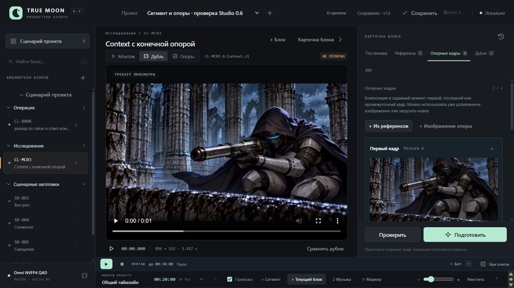

# Studio 0.6 / UI-06B — проверка сегмента и материалов

Дата: 31.10.2026. Запрос: «добавим предпросмотр отдельного сегмента и разделим референсы и опорные кадры на отдельные вкладки». Выпуск реализован и проверен без GPU в отдельном проекте на loopback-порту 8793. Авторский Studio на 8787 не перезапускался.

## Реализовано

- Из карточки сценарного сегмента открывается ограниченный просмотр: глобальная музыка и абсолютное время сохраняются; локальные часы/ползунок, стоп к началу, повтор после конца, возврат к карточке и переключение на весь проект. Паузы/заглушки остаются видимыми. Невалидный соседний сегмент не блокирует допустимый выбранный диапазон; общий просмотр проверяет весь план.
- «Референсы» содержит изображения, роли, Picture-порядок и отметки использования в Guides. «Опорные кадры» содержит миниатюры, первый/последний/промежуточный индекс, Picture-привязку, добавление из существующего набора или загрузку нового изображения. Удаление Guide сохраняет reference; удаление reference снимает связанные Guides. Новых серверных схем, миграций или изменений H3-сборщика нет.
- Исправлена найденная при реальной загрузке потеря FileList: список копируется до await, input очищается перед следующим открытием chooser. Асинхронная загрузка/перестановка не заменяет переключённый или уже редактируемый блок.

[Инструкция](../SegmentPreview.md), [машинные результаты](SegmentPreview.v1.Checks.json).

## Проверка в браузере

Использованы копия изолированного сценарного проекта, существующие MP4/PNG и Nero-Satisfy.mp3. Сегмент 20–24 с содержит видео CL-000A на 20–22 с и чёрный хвост. Соседнее видео намеренно начинается на 24 с; музыка начинается на 8 с с входом в исходник 44 с.

1. «Просмотр сегмента» показал локальные 00:00 / 00:04 и общие 00:20. Воспроизведение прошло video → gap и остановилось ровно на 24 с / локальных 4 с; соседний clip не посещён. DOM-телеметрия: buffer_ticks 0, resyncs 0, max native-video drift 0,1325 с. Музыкальный offset и ограничение длительности дополнительно проверены прямым тестом планировщика. Браузерные часы не доказывают покадровую синхронизацию будущего экспорта.
2. Home/Right на локальном ползунке дали 20,042 / локальные 0,042 с при 24 fps; стоп вернул 20 / 0. Проверены «К сегменту», «Весь проект» и смена проекта. В новом проекте старая область сбрасывается; повторный выбор диапазона работает.
3. В проект добавлен соседний сегмент без заданного окна: общий просмотр блокируется, просмотр допустимого 20–24 работает. Неопределённый сегмент затем убран; глобальный просмотр снова доступен.
4. В CL-MC03 показаны 5 references и две опоры: Picture 4 / 0 и Picture 5 / −1. Простое переключение вкладок сохранило revision и оба хэша генерационных входов CL-000A/CL-MC03. В References отсутствуют контролы Guides, в Guides — поля ролей.
5. Добавлена третья опора из существующего reference с предложенным индексом 28, сохранена и снята. Picture 4 переставлен вниз: первая/последняя опоры отобразились как Picture 5/4 с теми же reference_id. Обратная перестановка восстановила Picture 4/5.
6. Реальная загрузка PNG через «Изображение опоры» дала шестой reference и третий Guide, сохранённые сервером. Удаление этого reference сняло только его Guide; исходный импортированный файл остался. Итоговые references/guides/prompt/settings/context совпадают по значениям с исходными. Хэш CL-MC03 после явных записей отличается только сериализацией settings.seconds: 2.0 → 2; это не изменение времени, состава или меток. Чистое чтение вкладок такой записи не вызывало.
7. Сервер 8793 остановлен и повторно запущен с тем же state-dir. После reload восстановлены revision 13, три сегмента, пять refs и две исходные опоры; предупреждений/ошибок browser console нет. Область просмотра как временное состояние после reload сброшена.

Автоматизация chooser дважды возвращала управление с большой задержкой; из этого не делается вывод о скорости приложения. Во втором проходе фактические upload 201 и PATCH 200 выполнены, результат проверен в UI/сохранённом проекте. В серверном логе был оборванный клиентский keep-alive (WinError 10053); сервер продолжил обрабатывать запросы, сохранённые данные проверены повторным запуском.

SHA256 обоих производственных Studio.project.json Клэр/опенинга совпали с baseline. В QA нет Jobs; генераций и подготовки ComfyUI не было. Иллюстрации/видео/канон и планы конкретного ролика не редактировались.

## Автоматические проверки

Полный финальный прогон: **165 Python за 16,263 с, 73 Node, исходный JS logic script PASS; exit 0**. Новые 23 Node проверяют выбранный scope, реальные значения времени и звука, неизменность входов, границы/дубли индексов, Picture-связи, вызовы загрузки и гонки асинхронных ответов. Старые проверки плеера сохранены. Python AST, node --check всех static/*.js и git diff --check пройдены. Процент покрытия не измерялся.

| Требование | Evidence |
|---|---|
| «предпросмотр отдельного сегмента» | `segment preview uses valid selected planned clips despite foreign issues and keeps global music`; `scoped playback uses absolute master clock stops at range end and restarts at range start`; реальный диапазон 20–24 с с соседним клипом на границе |
| «разделим референсы и опорные кадры на отдельные вкладки» | `material tabs expose separate controls and route upload or drop with explicit guide intent`; раздельные контролы в браузере, чтение без изменения хэшей |
| Связи и пределы Guides | `guide frame preference is first last middle interior with normalized last and four-guide cap`; `reference removal renumbers pictures and removes only linked guides without mutating input`; реальные перестановка и удаление |
| Смена области/чужая правка | `deleted or invalid selected scope during sync pauses stops source clears range and reports error`; `late reorder response cannot replace a switched or newly dirty block`; переключение двух проектов в UI |

Тестовый skill-процесс включал assertion/gap review: конкретные значения, порядок ID, отрицательные эффекты, отмена поздних ответов и неизменность входов. Static source/test pairing вызван, но недоступен без tree-sitter-language-pack; зависимости ради него не устанавливались. Имитации не заменяли реальную браузерную проверку загрузки/сохранения.

## Снимки

Дополнительный звук сегмента (UI-08A), задания агенту из сценарной карточки (UI-03B), визуальные уточнения карточек и экспорт остаются открытыми. Этот выпуск не меняет качество/скорость видеомодели. Тестовая вкладка и принадлежащий проверке сервер 8793 закрыты после проверки.
