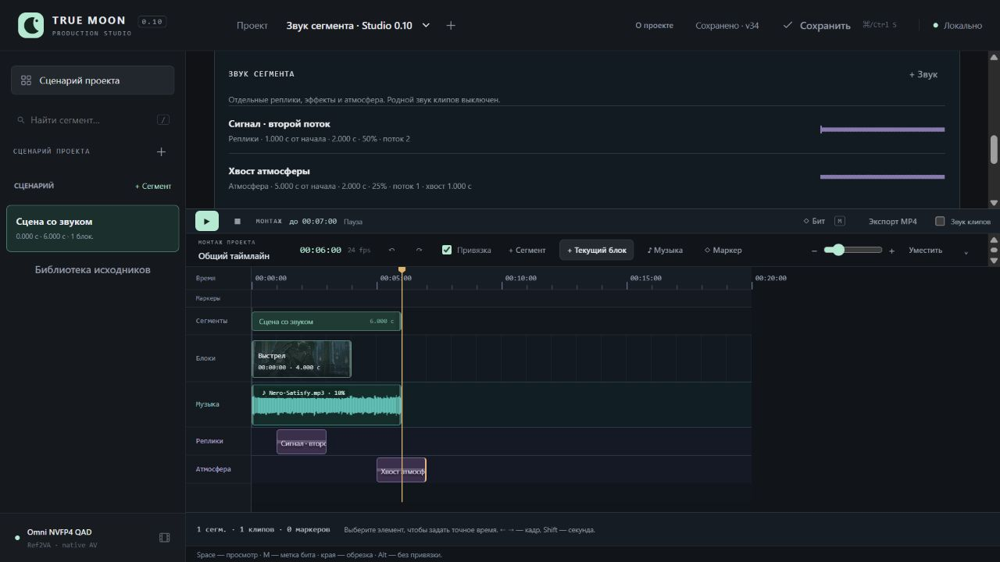
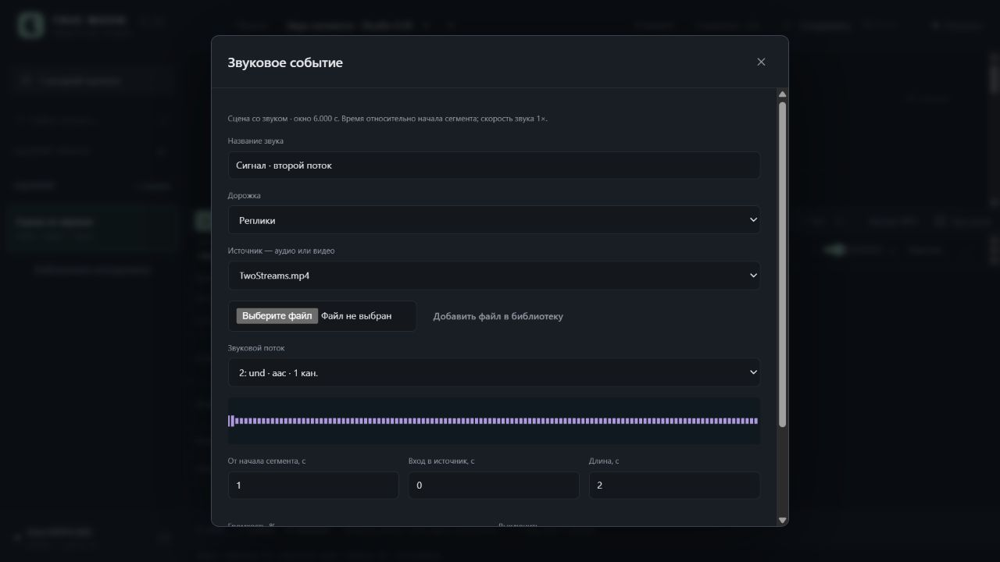

# Studio 0.10 / UI-08A — звук сегмента

31.10.2026. [Инструкция](../SegmentSound.md), [машинные результаты](SegmentSound.v1.Checks.json). Добавлены звуки из аудио/выбранного потока видео, участки/относительные позиции/gain/mute, волны, общий/сегментный preview и MP4. Первый выпуск использует три фиксированные роли дорожек; произвольные шины и drag звуков остаются в плане.

## Реальная проверка

Изолированный sound-qa в `UI/.local/sound-qa-20261031-r1/`, собственный loopback-сервер 8797, браузер 1280×720. GPU/ComfyUI не запускались, пакеты не устанавливались. Хэши авторских проектов Клэр и опенинга совпали с исходными; рабочий сервер 8787 не изменялся.

В сцене 0–6 с размещён CL-000A на 0–4 с, музыка Nero с 44 с источника на 0–6 с, gain 0,1; native звук клипов выключен. Создан локальный тестовый MP4 с двумя различимыми аудиопотоками (440/880 Hz, AAC).

Через форму «+ Звук» добавлены:

- «Сигнал · второй поток»: поток 2 (API ordinal 1), источник 0–2 с, начало в сегменте 1 с, gain 0,5, дорожка «Реплики».
- «Хвост атмосферы»: поток 1 (ordinal 0), источник 0,5–2,5 с, начало 5 с, gain 0,25, «Атмосфера». Хвост 1 с за окном явно показан; общий монтаж стал 7 с.

В карточке/таймлайне появились волны и отдельные дорожки. Нажатие на событие таймлайна открывает форму с прежним потоком/участком/громкостью. Общий просмотр завершился на 7,000 с, выбранный сегмент — на 6,000 с. WAV-кэш содержит только два выбранных двухсекундных участка. Это проверка воспроизведения/состояний и цифрового содержимого; художественное прослушивание не заявляется.

Перенос сегмента с 0 на 2 с передвинул начало сигнала с 1 на 3 с (left 32 → 96 px при 32 px/s), музыка осталась на 0. Отмена вернула сигнал на 1 с и оба события целиком. Изменение/уплотнение видеоблоков без сдвига звука дополнительно закреплено автоматическим тестом.

UI → «Экспорт MP4» дал export-ea55181aad144dda: **7,000 с, 168 кадров, 24 fps, 896×516, H.264/AAC**, worker **1,641 с**. Снимок v32; перенос/отмена позже дали v34. После перезапуска сохранились два события, потоки/поля, WAV-кэш и единственный готовый MP4. UI честно отметил старую revision экспорта; автоматического повтора нет. Собственные сервер и вкладка QA закрыты после проверки.

## Проверка микса

Независимый PyAV-декодер построил эталон из выбранных исходных потоков, участков, позиций и gain плюс музыка; логика FFmpeg-сборщика при построении эталона не использовалась. Сравнение внутренних окон при 48 kHz:

| Окно | Корреляция | RMS результата / эталона |
|---|---:|---:|
| Музыка 0,15–0,85 с | 0,99494 | 0,99340 |
| Музыка + второй поток 1,15–2,85 с | 0,99912 | 0,99637 |
| Хвост первого потока 6,15–6,85 с | 0,99999 | 0,99837 |

Отклонения ожидаемы после AAC. Это подтверждает выбор разных потоков, участка, положения и уровня, включая звук после конца музыки/сегмента; побитовое совпадение и захват выхода браузерной звуковой карты не заявляются. SHA256 донора и готового MP4 проверены. Скрипт/численные результаты находятся в QA-папке, сводка перенесена в Checks.json.

## Тесты

Полный набор: **225 Python**, **115 Node cases + базовый script** (116 runner entries), exit 0. После последнего расширения agent context узкие 12 Python прошли повторно; 10 новых Node тоже прошли. AST и node --check проверены. Broad test workflow/review сохранён в отдельном TEMP, static pairing не повторялся после ранее установленного отсутствия tree-sitter-language-pack; установки/замера процента покрытия не было.

| Requirement | Evidence |
|---|---|
| Относительное время, ripple/move/removal/undo | `test_segment_move_follows_offset_while_clip_ripple_does_not_move_sound_and_removal_undo_restores` |
| Валидация полей/участков/потоков и atomic conflict | `test_source_boundaries_validation_stream_types_and_revision_failures_are_atomic` |
| Реальный multistream анализ и cut-preview | `test_real_multistream_analysis_preview_and_hash_cache_select_requested_audio_only` |
| Кэш SHA/stream/in/duration/fps, отсутствие лишних записей | `test_preview_cache_ignores_placement_gain_but_keys_cut_and_stream_without_project_writes` |
| Файл без звука | `test_no_audio_source_refuses_binding_without_project_migration_or_event` |
| Настоящий MP4 с музыкой/выбранным потоком/gain/mute/source-in | `test_real_mp4_mixes_music_and_selected_stream_at_relative_start_gain_and_ignores_muted_sound` |
| Контекст агента, уникальные доноры и snapshot | `test_export_plan_includes_relative_sound_tail_and_immutable_selected_stream` |
| HTTP read-only, Range/HEAD и CLI | `test_audio_stream_waveform_selected_query_and_preview_range_head_do_not_commit_project`; `test_cli_timeline_read_and_explicit_file_write_keep_literal_sound_operation_and_revision` |
| Окно сегмента и звуковой хвост | `sound tail extends full project but chosen segment keeps window and excludes other segment events` |
| Player seek/pause/поздний ответ | `player schedules selected cut and seek uses local offset while pause stops all event nodes`; `pause during sound decode or project switch cannot schedule stale buffers` |
| Форма и сохранение draft при конфликте | `SoundDesk form converts seconds stream gain and keeps draft on conflict with pending guard` |
| Полный успешный прогон (cwd UI) | `python -s -B -m unittest discover -s tests -q`; `node --test --test-reporter=dot tests/test_*.mjs` |

При QA исправлен UTF-8 stdout/stderr дочернего аудиоанализатора Windows. Контекст переносит зарегистрированный SHA доноров при наличии; не вычисляет отсутствующий legacy SHA по умолчанию.

Дальнейшая очередь: UI-04E — плавные переходы, UI-04F — титры; отдельные улучшения звукового редактора и согласование UX-компоновки.

