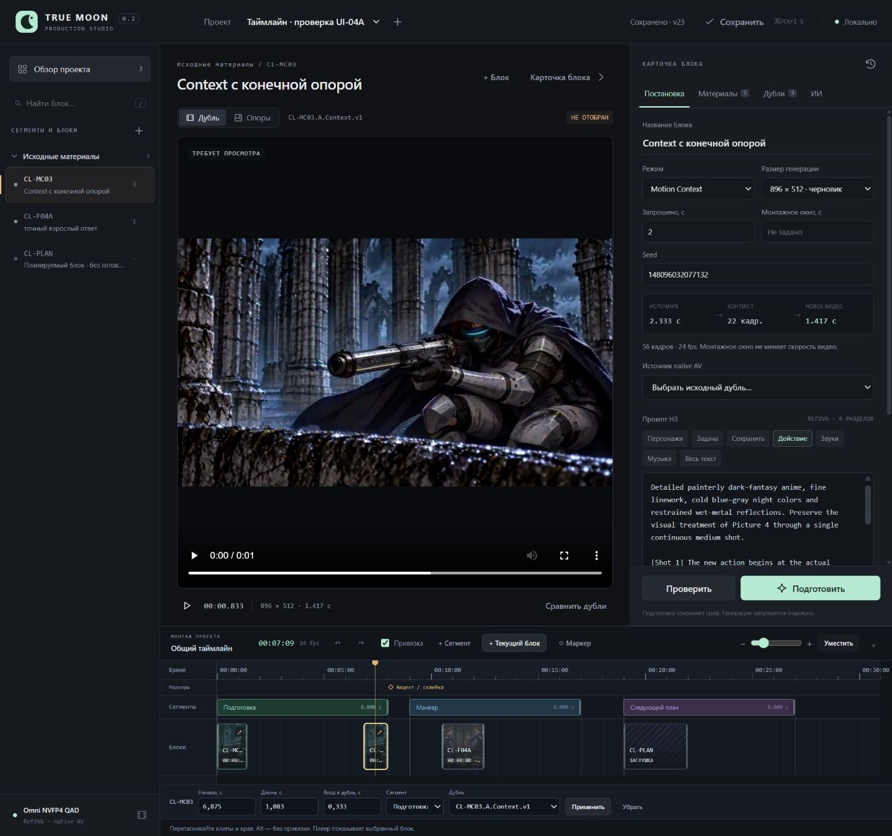

# UI-04A — общий таймлайн, Studio 0.2

31.10.2026. Реализован согласованный первый этап общего монтажа. [Инструкция](../Timeline.md), [контракт API](../API.md), [машинные проверки и хэши](Timeline.v1.Checks.json).

## Результат

Шкала всего проекта с таймкодом минут/секунд/кадров, курсором, масштабом и делениями. Цветные диапазоны сегментов с вертикальными границами; клипы с миниатюрами и заглушки. Работают перенос мышью клипов/сегментов, перенос клипа между сегментами, изменение краёв, точные поля, выбор дубля, маркеры и привязки. Сдвиг группы сохраняет внутренние интервалы. Монтажные позиции/участки лежат на сетке fps проекта; видео остаётся на скорости 1×.

Отмена/повтор до 30 монтажных действий сохраняются вместе с проектом; промпты, дубли и их отбор не откатываются. Изменения проверяются по expected_revision; 409 сохраняет чужую версию. UI и агент используют один GET/POST timeline API. Генерация при этих операциях не вызывается.



## Браузерная проверка

Проверка выполнена через настоящий интерфейс на отдельном проекте `Таймлайн · проверка UI-04A` в игнорируемом UI/.local. Источники — ссылки на существующие видео/кадры Клэр; в проект ролика тестовый монтаж не переносился.

- Созданы три сегмента, два размещения одного MC03, заглушка CL-PLAN и маркер на 8 с.
- Клип мышью передвинут с 8 с на 10,333 с. Сегмент «Следующий план» сдвинут с 16 на 19 с вместе с заглушкой; «Манёвр» — с 8 на 9 с вместе со своим клипом, сохранив относительную позицию.
- Клип перенесён из «Манёвра» в «Подготовку», его конец привязался точно к маркеру 8 с: start 158, duration 34, end 192 кадра.
- Левый край обрезан на 8 кадров: source_in 8, duration 26. Отмена восстановила source_in 0/duration 34, повтор вернул обрезку. Стрелкой клип сдвинут ещё на один кадр влево: start 165, source_in 8, duration 26.
- CL-F04A перетащен из дерева в свободный интервал и получил отдельное монтажное размещение. Позднее в форме заглушке назначен настоящий дубль. Старый video_info={} восполнен чтением MP4: 56 кадров, 24 fps, 2,333 с. Исходный файл не переписывается.
- Попытка наложить этот клип на другой отклонена сообщением «Клипы пересекаются»; сохранённая позиция 10,5 с сохранилась. Правый край изменён с 2 на 1,625 с, затем отменён.
- Граница первого сегмента численно изменена с 8 на 9 с, затем отменена. Проверены масштабирование, «Уместить» и покадровое перемещение клавиатурой.
- Клик по линейке на frame 177 → таймкод 00:07:09 → позиция исходного MC03 0,833333 с, media error отсутствует. Это просмотр отдельного источника, а не воспроизведение всего проекта.
- После перезапуска сервиса восстановлены монтажные диапазоны/клипы/маркер и история. Итог тестового проекта: 3 сегмента, 4 клипа, 1 маркер, revision 23. Хэши настоящих Studio.project.json Клэр и опенинга совпадают с исходными; тестовых заданий генерации нет.

В ходе QA исправлены HTML-проверка шага длительности сегмента, pointer-перенос источника без зависимости от HTML5 dataTransfer и чтение недостающей длительности старых MP4. Метаданные записываются только вместе с успешной монтажной операцией; неудачный участок не оставляет частичных правок.

## Автоматическая проверка

**89 Python-тестов — OK, 6,780 с**. Новые Node timeline tests — **14/14 PASS**; прежняя проверка JS-логики — PASS. Синтаксис ES modules и Python AST проверен. GPU, ComfyUI и экспорт не запускались.

```powershell
& 'E:/ComfyUI_windows_portable/python_embeded/python.exe' -s -B -m unittest discover -s TrueMoonTales/AMV/UI/tests -p 'test_*.py' -q
node TrueMoonTales/AMV/UI/tests/test_logic.mjs
node --test TrueMoonTales/AMV/UI/tests/test_timeline_logic.mjs TrueMoonTales/AMV/UI/tests/test_timeline_view.mjs
```

| Требование | Свидетельство |
|---|---|
| «общий таймлайн со шкалой времени» | JS `project frame conversion and clock preserve frame boundaries`, `ruler spacing includes exact threshold and next smaller zoom`; снимок и клик курсора выше |
| «переносить сегменты» | `test_move_segment_shifts_its_clip_group_and_preserves_offsets_and_other_segment`; реальный pointer-перенос двух сегментов |
| «переносить … блоки» | `test_update_clip_transfer_validates_new_segment_and_source_then_preserves_identity`; pointer-перенос между диапазонами и из дерева |
| «отметки с делениями сегментов» | `test_segment_touch_is_allowed_but_one_frame_overlap_is_atomic`; диапазоны, подписи и вертикальные границы на снимке |
| Обрезка и нормальная скорость | `test_trim_uses_seconds_capacity_exact_source_end_and_does_not_change_review`; JS left/right trim tests и браузерная обрезка обоих краёв |
| Привязки | JS `snap moves leading or trailing edge and respects inclusive threshold`; точное совпадение конца клипа с frame 192 маркера |
| Сохранение/отмена | `test_undo_redo_only_timeline_after_unrelated_notes_take_and_generation_edits`, `test_stale_revision_does_not_undo_or_overwrite_newer_timeline` |
| Сохранение черновика блока при конфликте и смене проекта | JS `block save conflict keeps its unsaved draft and resolution UI without timeline refresh`, `late add response cannot select an old project item after switching projects` |
| Заглушки и старые дубли | `test_placeholder_has_no_source_in_and_can_later_bind_a_take`, `test_legacy_add_and_update_bindings_probe_once_preserve_review_and_reuse_metadata` |
| Атомарность/общий API/отсутствие генерации | `test_missing_token_stale_revision_and_invalid_frames_never_commit`, `test_placeholder_edit_and_undo_through_http_do_not_start_generation` |

## Границы выпуска

В старом проекте шкала изначально пустая; исходные группы карточек не становятся автоматически монтажными сегментами. Размещать нужно выбранные блоки/дубли, оставляя исследования в библиотеке. Сегменты/клипы находятся на одной монтажной полосе без перекрытий и автоматического сдвига соседей; пустые интервалы допустимы.

Музыкальная волна/дорожка, переходы, титры, непрерывное воспроизведение всей последовательности и экспорт — следующие части UI-04. Плеер пока проигрывает выбранный источник, не собранный ролик. Арт/видео не регенерировались, художественной приёмки тестовый монтаж не означает. Основная проверка компоновки выполнена на настольном экране.

Собственные серверы проверки остановлены. Для обычной работы использовать Start-Studio.cmd; тестовый проект не добавлен в основной реестр.
