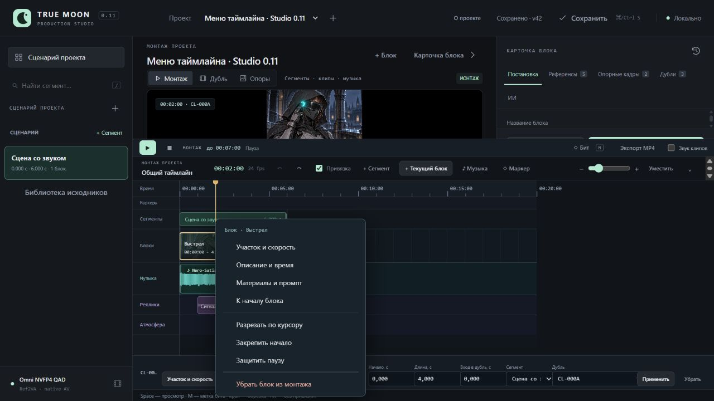
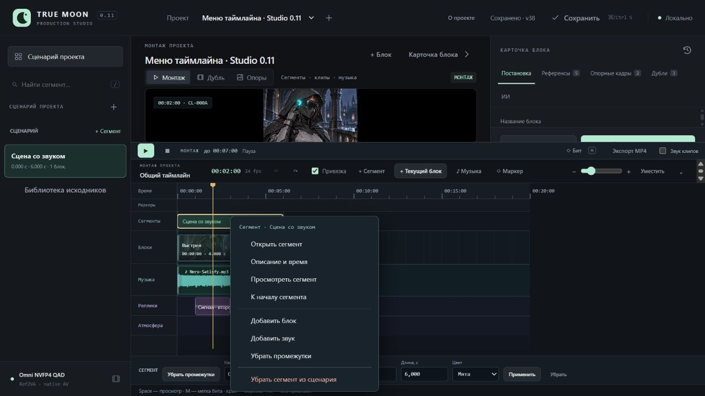

# Studio 0.11 — контекстное меню блоков и сегментов

31.10.2026. [Инструкция](../TimelineMenu.md), [машинные проверки](TimelineMenu.v1.Checks.json). Frontend использует существующие операции/формы, новых API и полей проекта нет.

Изолированный menu-qa, собственный сервер 8798, браузер 1280×720. Правый клик открыл меню клипа; Shift+F10 — то же меню с клавиатуры. При курсоре 0 разрез отключён, открытие не двигает курсор. Закрепление дало отметку и badge «фикс.»; Escape вернул фокус клипу, undo снял закрепление.

Курсор установлен на 2 с через линейку. Меню разрезало четырёхсекундный блок на два по 2 с, с согласованными входами 0/2 с. Undo вернул один блок. Меню сегмента открыло формы времени и добавления звука; меню клипа — редактор участка/скорости. Удаление блока и сегмента проверено с последующей отменой: восстановились 1 клип, 1 сегмент и 2 звуковых события. После восьми операций/отмен revision 34 → 42; канонический монтаж, блоки, assets, библиотечные сегменты совпали с исходными. Авторские проекты Клэр/опенинга сохранили SHA256, рабочий сервер 8787 не менялся. GPU/ComfyUI не запускались.

Меню наблюдалось в границах окна, текущие checked/disabled состояния показаны. Console error/warn — 0. Собственная вкладка и сервер QA закрыты после проверки.

Полный набор прошёл: **225 Python**, **124 Node cases + базовый script** (125 entries). Добавлены 9 focused Node cases для одного компонента; реальные UI-проверки дополняют минимальную DOM-модель тестов. Новых библиотек/тестовой инфраструктуры не устанавливалось.

| Requirement | Evidence |
|---|---|
| Команды блока и прежние операции | `clip menu commands reuse montage actions` |
| Команды сегмента и область действия | `segment menu commands use scoped callbacks and preserve source operations` |
| Границы split, заглушка и сохранение | `clip menu disables missing media pending edits and split boundaries` |
| Открытие без записи/сдвига курсора, viewport | `context menu selects without moving playhead and fits the viewport` |
| Клавиатура, отключённые пункты, Escape/focus | `context menu keyboard skips disabled items and restores focus on escape` |
| Закрытие, повторное открытие, очистка слушателей | `context menu closes outside on scroll resize tab and replacement without leaking listeners` |
| Смена проекта/revision/исчезновение элемента | `context menu rejects stale project revision removed targets and pending writes` |
| Один запуск команды и обработка ошибки | `context menu dispatches one captured action and reports callback failure` |
| Shift+F10/Menu только для блоков/сегментов | `timeline menu key targets only blocks and segments` |
| Успешные команды (cwd UI) | `node --test tests/test_timeline_menu.mjs`; `node --test --test-reporter=spec tests/test_*.mjs`; `python -s -B -m unittest discover -s tests -q` |

При проверке исправлен порядок восстановления globals в тестовой DOM-модели. В рабочем компоненте открытие синхронизирует selection с render signature, чтобы очередной обычный poll не закрывал меню. Меню перехватывает клавиши: Space не запускает монтаж поверх действия.

